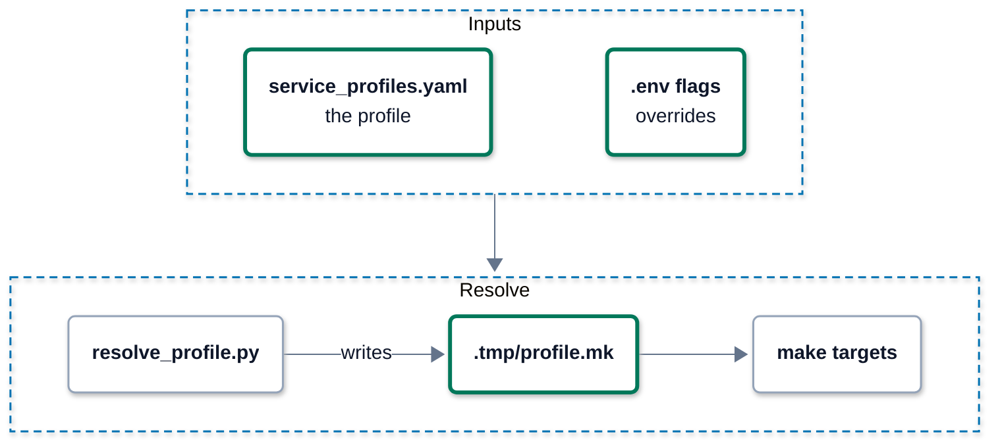

# Contributing

We welcome contributions to this project. By contributing, you agree to the
terms outlined below.

## Commit Message Format

HyperI projects use [Conventional Commits](https://www.conventionalcommits.org/)
and [semantic-release](https://semantic-release.gitbook.io/) for automated
versioning and changelog generation. All commits must follow this format:

```
<type>(<scope>): <subject>

[optional body]

[optional footer(s)]
```

### Types

| Type | Description | Version Bump |
|------|-------------|--------------|
| `feat` | A new feature | Minor (0.X.0) |
| `fix` | A bug fix | Patch (0.0.X) |
| `docs` | Documentation only | None |
| `style` | Code style (formatting, semicolons, etc.) | None |
| `refactor` | Code change that neither fixes a bug nor adds a feature | None |
| `perf` | Performance improvement | Patch (0.0.X) |
| `test` | Adding or correcting tests | None |
| `build` | Changes to build system or dependencies | None |
| `ci` | Changes to CI configuration | None |
| `chore` | Other changes that don't modify src or test files | None |
| `revert` | Reverts a previous commit | Varies |

### Breaking Changes

For breaking changes that require a major version bump, add `!` after the type
or include `BREAKING CHANGE:` in the footer:

```
feat!: remove deprecated API endpoints

BREAKING CHANGE: The /v1/users endpoint has been removed. Use /v2/users instead.
```

### Examples

```
feat(auth): add OAuth2 support for Google login

fix(api): handle null response from upstream service

docs: update installation instructions for Windows

refactor(core)!: restructure module exports

BREAKING CHANGE: Named exports are now used instead of default exports.
```

### Scope

Scope is optional but recommended. Use it to indicate the area of the codebase
affected (e.g., `api`, `auth`, `core`, `cli`, `docs`).

## Semantic Versioning

This project follows [Semantic Versioning 2.0.0](https://semver.org/):

- **MAJOR** (X.0.0): Breaking changes that require users to modify their code
- **MINOR** (0.X.0): New features that are backwards-compatible
- **PATCH** (0.0.X): Bug fixes and minor improvements

Versions are automatically determined by semantic-release based on commit
messages. Do not manually update version numbers.

## License for Contributions

All contributions to this project are licensed under the Business Source
License 1.1 (BUSL-1.1), the same license that covers the project.

Each version of the software (including your contributions) will automatically
become available under the Apache License, Version 2.0 on the third
anniversary of its release.

## How to Contribute

1. **Fork the repository** and create your branch from `main`
2. **Make your changes** following the commit message format above
3. **Test your changes** to ensure they work as expected
4. **Submit a pull request** with a clear description of what you've done

### Pull Request Checklist

- [ ] Commits follow the conventional commit format
- [ ] Tests pass (if applicable)
- [ ] Documentation is updated (if applicable)

## Run the checks locally before you push

HyperI projects gate every push through CI (lint, format, tests, secret scan,
dependency audit, build). Run the SAME checks locally first so your change lands
green instead of bouncing:

```
hyperi-ci check
```

`hyperi-ci` is the HyperI CI CLI (public on PyPI). If you do not have it, install it once with `uv tool install hyperi-ci` (or `pipx install hyperi-ci`) or run it ad hoc with `uvx hyperi-ci check`. It runs the project's full local validation - the same suite CI runs - and reports what to fix. Run it before every push and before opening a pull request. It is the single best way to give your change the best chance of surviving CI.

## CI/CD Workflow

When a merge to `main` carries `Release: true` as the last line of its commit body:

1. **semantic-release** analyses commit messages since the last release
2. Determines the next version number based on commit types
3. Generates/updates the CHANGELOG
4. Creates a new GitHub release with release notes
5. Publishes the package (if applicable)

A merge without the trailer runs CI and releases nothing. `hyperi-ci release` releases the current `main` without a new commit.

## Questions

If you have questions about contributing, please open an issue or contact us.

## Context

### What this is

dfe-docker stands the whole DFE suite up as one Docker Compose stack on a single host and it is the definition-of-done target for the suite's docker path: a change is proven when it runs on the deployment target, not because it ran on someone's laptop. It packages the stack: its release builds the dfe-docker image that sets a folder up from this tree, publishes it with the Compose artefacts and `quickstart.json` and builds no component image (`make dev` builds those locally, for a test rig). It provisions no ClickHouse table and no Kafka topic. dfe-engine is the only schema and topic controller and `scripts/tests/test_engine_only_schema_control.py` fails the build on a DDL file or a topic-creating step appearing here. When the data path is wrong the fix is nearly always in a component repo. It is not the Kubernetes path either: Kubernetes stays primary and dfe-infra owns it, which is why there is deliberately no `scale` profile - Compose cannot run an HA broker or a ClickHouse cluster. `main` is protected, so every change arrives as a pull request, with Conventional Commits ([CONTRIBUTING.md](CONTRIBUTING.md)).

### Where things live

| Path | What it holds |
|---|---|
| `docker-compose.yml` | Every service and every infrastructure profile. The one file `make ci` names explicitly |
| `compose/` | The opt-in overlays the Makefile chains: `live-ui`, `storage`, `tls` and `container-logs`. It writes the exposure opt-outs and the dev build's local images into `.tmp/` beside them |
| `service_profiles.yaml` | Which DFE services start, the transport and the config each one mounts. Ships `active_profile: single`, which `make ci` and `make dev` run. `make up` and `make demo` default to the same profile on a clone with no image pins |
| `Makefile` | Every entry point, plus the profile, overlay and UI-exposure resolution that decides which compose files a target passes |
| `scripts/resolve_profile.py` | Reads `service_profiles.yaml` and writes the generated `.tmp/profile.mk` the Makefile includes |
| `scripts/stack.py` | `make stack` - writes `tag@sha256` pins into `.env` from a local dfe-infra checkout (`DFE_INFRA_DIR`) or the signed OCI stack manifest |
| `scripts/post.py` | The power-on self test `make dev` and `make ci` end with |
| `docker/dfe-docker.Dockerfile` + `scripts/installer.py` | The `ghcr.io/hyperi-io/dfe-docker` image and its entrypoint, which copy this tree into a folder and run its scripts there. `.dockerignore` lists what the image carries. `.github/workflows/image.yml` builds it on each release and attaches `quickstart.json` from `scripts/quickstart_json.py` |
| `scripts/test_e2e.py` + `tests/e2e/e2e-tests.yaml` | The declarative e2e suite, one stack per test |
| `scripts/check_*.py` | The gates `make check` runs |
| `scripts/tests/` | Unit tests over the helper scripts, which CI runs beside the static checks |
| `config/<component>/` | The config files services mount, one directory per component |
| `.env.example` + `env.example/` | Committed templates. `make init` copies them to `.env` and `env/`, both gitignored |
| `ops/daemon-update/` | The systemd timer that keeps a single-VM deployment on the newest certified stack |
| `docs/` | The guides for evaluating, operating, deploying, developing and troubleshooting the stack, plus profiles, configuration and observability. Read [docs/architecture.md](docs/architecture.md) first |

### Commands that prove a change

```bash
make check       # every static gate CI runs
make check-tests # pytest over scripts/tests only
make dev         # build from source, start, self-test
make ci          # pull the pinned registry images, start, self-test
make post        # re-run the self test against an already-running stack
make test-e2e    # the declarative suite, one stack per test
make down        # stop and remove containers across EVERY profile
```

`make check` is `check-compose check-hardfail check-dockerfile check-docs check-proxy check-python check-tests check-locks` and CI runs each one through the same make target so the two cannot drift.

Two ways a green run says less than it looks:

- `make check` does not start the stack. It resolves compose, lints the helpers and unit-tests them and `check-proxy` runs temporary Envoy containers to validate the proxy config. CI's image and published-compose jobs start the stack from the dfe-docker image and check each demo source lands rows, but CI runs neither `make post` nor `make test-e2e`, so run those for a change to the data path.
- `check-compose` validates compose STRUCTURE, not digests. It substitutes placeholders for the mandatory keys so it reads neither the stack SSoT nor the registry, which means no particular pin is proved to resolve.

`check-hardfail` resolves compose with a scrubbed environment and an empty `--env-file` so a developer's pinned `.env` cannot mask it, requires the run to fail on a missing pin, then reads every `image:` line and requires each to resolve to an `@sha256:` digest.

### What tends to bite

| Don't | Do | Why |
|---|---|---|
| Leave containers running when you are finished | `make down`, on every host you touched, the same session | `down` removes containers across every profile, not only the active one, so a previous profile's containers cannot stay up holding host ports and answering health probes (`Makefile`, the `down` target) |
| Assume the deployment target is idle | Check what is already running before you start anything | The docker definition-of-done target carries a long-lived stack refreshed on a 6-hourly systemd timer (`ops/daemon-update/`), not a box you get to yourself |
| Assume events go through Kafka | Read the profile's `transport` first | `slim` is `transport: grpc`: the receiver dials `dfe-loader:6000` directly and no broker starts. `single`, the shipped profile, is `transport: kafka` and starts one. The core data path is otherwise identical. `post` and `test-e2e` assert the same landing row either way |
| Add a DDL file or a topic-creating step here | Change the schema in dfe-engine | dfe-engine ships the schemas in its own image and reports healthy only once it has applied them. `scripts/tests/test_engine_only_schema_control.py` checks the deployment trees for the schema and topic bootstrap patterns it knows, with exceptions for the self-test and the e2e cleanup (#118) |
| Give an external ClickHouse's port through `CLICKHOUSE_HTTP_PORT` or `CLICKHOUSE_NATIVE_PORT` | Set `CLICKHOUSE_EXTERNAL_HTTP_PORT` and `CLICKHOUSE_EXTERNAL_NATIVE_PORT` | The first pair is the bundled container's host publish and nothing else, so it is safe to move for a second stack. Services on the network dial 8123/9000 unless the EXTERNAL pair says otherwise (#75) |
| Move the loader's `grpc.listen` off 6000 or confuse it with the receiver's 6000 | Keep the loader on container port 6000 | dfe-engine compiles every sender's loader endpoint as `dfe-loader:6000`, so a loader listening anywhere else drops every record behind an HTTP 202 with nothing logged. The receiver's 6000 is the external Vector protocol, off until `config.grpc.enabled` is set through the engine, because under `--config` the receiver takes only its flat env keys and unpublished until `DFE_RECEIVER_GRPC_PORT` is set. The loader's is the internal `scalo.transport.v1.Transport/Push` and publishes no host port. `scripts/tests/test_loader_grpc_port.py` fails the build on a mismatch |
| Publish the UIs beyond loopback and leave `DFE_EXTERNAL_ORIGIN` alone | Set it to the address browsers actually use | `DFE_BIND_SCOPE=all` with a loopback origin builds Search's frame-ancestors policy and every next-auth redirect from the wrong host, so the console comes up with its observability views blocked and sends logins to the wrong machine. The Makefile now refuses the combination (#108) |
| Raise `REDPANDA_MEMORY` on its own | Raise `DFE_BROKER_MEMORY` above it | The broker gets at most the container limit less the host's `vm.min_free_kbytes`: `redpanda/start.sh` lowers `--memory` to that and logs a WARN naming the `DFE_BROKER_MEMORY` that restores it (`.env.example:229`, `.env.example:519`) |
| Publish the broker's in-network listener `9092` to the host | Use the host listener on `19092` (`KAFKA_PLAINTEXT_HOST_PORT`) | `9092` advertises `kafka:9092`, a name a host client can't resolve. It also collides with an always-on dev Kafka (#36) |
| Set `DFE_UPDATE_WIPE_STATE=1` on a box that also sets `DFE_DATA_ROOT` | Leave `DFE_DATA_ROOT` unset if you rely on the wipe | `make clean` does not chain the storage overlay, so it removes the volume objects while the bind directories keep their contents and the wipe silently becomes a no-op (`ops/daemon-update/README.md`) |
| Take a local, gitignored note as current | Read the tracked file you are asking about | A local note is nobody's to maintain and the ones seen so far named repos and directories that no longer exist |

### Profile resolution

Compose profiles select infrastructure. `service_profiles.yaml` selects DFE services. `scripts/resolve_profile.py` reads the second and derives the first, and writes `.tmp/profile.mk` for the Makefile to include. Each service entry names the config file it mounts, which is how one service gets a Kafka config and another a gRPC one without a second compose file.



*Figure 1. L4 Detail -- Profile resolution. The flags are `DFE_PROFILE` and the footprint toggles such as `DFE_CORE_ENABLED`.* Up: [L2 Services -- DFE Compose stack](docs/architecture.md).

### Start order

`compose/one-shots.yml`, included by `docker-compose.yml`, holds every container that runs once and exits: dlq-init, bearer-tokens-init, the `contract-<app>` emitters, dfe-dashboards, hyperdx-documentdb-tls, and a `config-check-<app>` for dfe-archiver, dfe-loader and dfe-receiver. A config check runs its app's `config-check` with the image, environment and config file the app is about to start with, once the engine has rendered that file. A key the app doesn't know still passes, because the apps ignore unknown keys.

The apps wait on `depends_on: dfe-engine: service_healthy`, because healthy means their tables and topics exist. A loader started first holds messages pending-schema and dead-letters them, which reads as data loss and is start ordering.

Each limit tier extends `base` in `compose/base.yml`, and its `dns_search: ["."]` clears the search domain the host passes into every container. A bare name with no alias (`kafka` on a stack without a broker) then fails to resolve, rather than reaching a host on that domain.

### Where this sits

The suite graph in `dfe-infra/suite.yaml` records exactly one edge on this repo and no outbound edges at all. Read it with `dfe-stack suite --consumer dfe-docker` and `--producer dfe-docker`.

| Repo | Direction | How they interact |
|---|---|---|
| dfe-infra | inbound, `derived-pins` | dfe-docker holds no copy of the pins. `scripts/stack.py` renders them at `make stack` time, from a local dfe-infra checkout when `DFE_INFRA_DIR` names one, else from the signed OCI stack manifest pulled with `oras`. `ops/daemon-update/self_update.py` is the second consumer of that manifest. The edge's declared check is "nothing" - there is no second copy that can drift and the graph records the edge so the suite tooling knows to walk past it. Do not go hunting for a pin file here to update |
| dfe-receiver, dfe-fetcher, dfe-loader, dfe-archiver, dfe-transform-elastic, dfe-transform-vector, dfe-transform-vrl, dfe-engine, dfe-ui, dfe-hyperdx | inbound | This stack runs their published GHCR images at the digests `make stack` pins and `make dev` builds the same components from source into local images. Nothing flows the other way |

Nothing in the suite graph depends on dfe-docker, so a change here breaks a deployment rather than another repo's build. `dfe-transform-splack` and `dfe-transform-wasm` have repos but no service in this stack.
