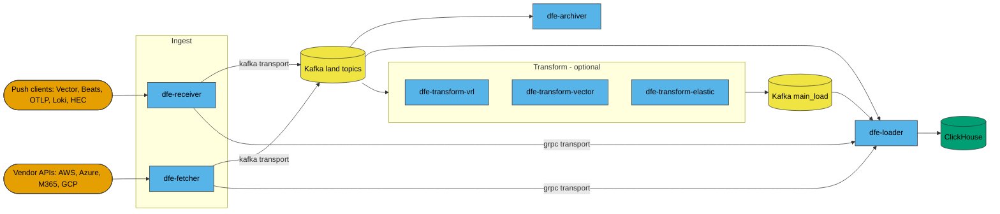
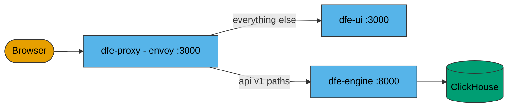
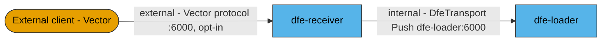
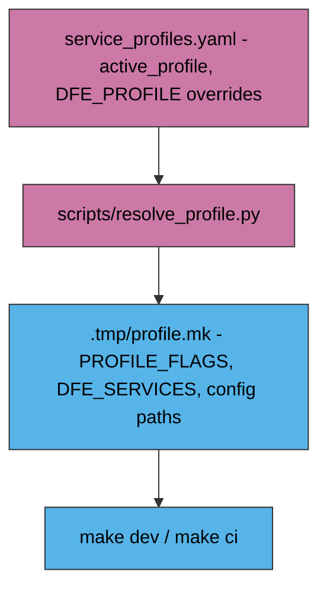

<!--
Project:   dfe-docker
File:      docs/architecture.md
Purpose:   How the DFE Compose stack fits together
Language:  Markdown

License:   BUSL-1.1
Copyright: (c) 2026 HYPERI PTY LIMITED
-->

# How the Compose stack fits together

This repo is **packaging, not product**. It ships a `docker-compose.yml`, the
config files the components mount, and Python helpers that resolve a profile and
pin image versions. It builds no production image and publishes nothing.

When something in the data path is wrong, the fix is almost always in a component
repo, not here.

## Events arrive two ways and leave one

Pushed to `dfe-receiver` or pulled by `dfe-fetcher`, and out through `dfe-loader`
into ClickHouse. Everything between is optional and profile-selected.

Transport is a per-profile choice, not a global one. On a `*-kafka` profile the
ingest components produce to a `*_land` topic derived from the event's `_source`,
and the loader consumes `topic_regex: .*_land`. On a `*-grpc` profile there is no
broker: the ingest components dial `dfe-loader:6000` directly.

The three transforms are bus-only today: each reads a topic and writes a topic. `dfe-archiver` archives each source from its landing topic on Kafka. No gRPC profile runs it, so archiving needs a Kafka profile. Once a transform writes `<base>_load`, the loader reads it instead of `<base>_land`, through the same `config/loader/kafka.yaml`: scalo drops `<base>_land` from its subscription once `<base>_load` exists.

## What each profile runs

`slim-*` is the core data path alone: receiver, loader, engine, UI and HyperDX. `single-*` adds the per-source apps its keys enable ([profiles.md](profiles.md#which-profile-runs-what)). The `-kafka` profiles add the broker. `single-kafka` also adds one archiver. None starts a per-source app until a source created through the engine binds one.

## The engine renders each app's config

On Kubernetes an app's chart turns its values overlay into a ConfigMap the pod mounts. Compose runs no chart, so dfe-engine does that step: it merges each instance's overlay over the committed `config/<app>/<transport>.yaml` and writes the app's config file, its programs and its enrichment tables into the `dfe-app-config` volume, one directory per app. Every app mounts that volume read-only at `/etc/dfe/apps`.

The committed file stays the DEPLOYMENT's (brokers, warehouse credentials, the spool) and the overlay wins wherever the two name the same key, so nothing deployment-specific is written into the deploy repo. `resolve_profile.py` turns this on wherever the core footprint runs.

dfe-fetcher and the three transforms have no committed file. The overlay is their whole config and their broker comes from `DFE_KAFKA_BOOTSTRAP_SERVERS` in their environment.

Nothing restarts a container. A change the running app cannot take in place is reported by the API as `restart required: make apply SERVICES=<app>` and one to its env file as `recreate required:` with the same command. `make apply` creates a per-source container the engine has only just declared, recreates one that exists and removes the container of a source the engine has deleted, which it finds by the `dfe.instance-of` label only generated services carry. A delete names no command, so `make apply` with no `SERVICES` does that removal alone and starts nothing.

## A source with its own transform gets its own instance

A source with a transform stops sharing `main_land`: the receiver routes it to
`<source>_land`, and only a transform reading THAT topic sees it. So a transform
is deployed once per source, as the Kubernetes tier deploys one per Source
definition -- input topic, program directory and output topic all carry the name.

The source and its transform are created through the engine, as the console does it. dfe-engine renders the instance's config into `dfe-app-config` and `make apply` starts a service that extends the committed `dfe-transform-vrl`, `dfe-transform-vector` or `dfe-transform-elastic`. Those committed services carry the broker env and nothing of a source's own. dfe-transform-vector also mounts `resources/enrichment/` at `/etc/dfe-transform-vector/data`, where its bundled filebeat pipeline reads `timezones.csv`. `make test-source` drives the filebeat, Vector and Elastic cases end to end.

dfe-transform-vector's one port carries everything. The wrapper scrapes Vector's `internal_metrics` off its `prometheus_exporter` on loopback and registers the samples on scalo's own recorder (dfe-transform-vector#70), so `vector_*` reads on the published port AND rides the OTLP push into the otel database. The exporter's 9598 is not published.

dfe-engine creates a transform's table and nothing here provisions it. Create the source before sending it data: a loader that meets rows for a table it has no schema for buffers them, then dead-letters them.

The source NAME propagates character for character: the engine requires a
Kubernetes DNS-1123 label (hyphens, never underscores, because a source-bound
app deploys one instance named for its source), the receiver substitutes it into
`<_source>_land`, and the loader strips `_load` back off for the table. So
`filebeat-vector` gives `filebeat-vector_land`, `filebeat-vector_load` and a
table name that needs backticks in SQL.

## The management plane rides alongside

Independent of transport, toggled as a unit by the `core` footprint key.

`dfe-proxy` exists to give the UI and the engine API one origin, because the UI
client calls the engine with a relative `/api/v1/...` base URL.

## Two gRPC listeners share port 6000 and they are not the same thing

| Container port | Host port | Owner | Protocol | Audience | Binds |
|---|---|---|---|---|---|
| 6000 | none, 6000 once its `docker-compose.yml` line is uncommented | dfe-receiver | Vector protocol, an ingest source that listens only with `DFE_RECEIVER_GRPC__ENABLED=true` | external clients | `DFE_INGRESS_BIND_HOST` (`0.0.0.0`) |
| 6000 | 50051 | dfe-loader | `DfeTransport/Push`, internal transport | receiver, fetcher, transform-vrl | `DFE_BIND_HOST` (`127.0.0.1`) |

Every Push listener in the suite answers on 6000, and dfe-engine compiles each sender's endpoint against that port. The loader publishes on host port 50051, which leaves 6000 for the receiver's listener. The binding split is the tell: the receiver's listener is meant to be reachable, the loader's is not.

## Two independent selectors decide what runs

Compose profiles select INFRASTRUCTURE. `service_profiles.yaml` selects DFE SERVICES. `scripts/resolve_profile.py` reads the second and derives the first, writing `.tmp/profile.mk` for the Makefile.

| Compose profile | Services |
|---|---|
| `clickhouse` | `clickhouse` |
| `kafka-redpanda` | `kafka-redpanda` |
| `kafka-apache` | `kafka-apache` |
| `kafka-ui` | `kafka-ui` (Kafbat) |
| `dfe` | `dlq-init`, archiver, fetcher, loader, receiver, every transform instance |
| `core` | `dfe-engine`, `dfe-ui`, `dfe-proxy` |
| `hyperdx` | `hyperdx`, `hyperdx-ferretdb`, `hyperdx-postgres` |
| `otel` | `otel-collector` |

A profile declares its whole footprint through the optional `clickhouse`, `core`,
`kafbat`, `hyperdx` and `otel` keys, each overridable by the matching `.env` flag.
Each service entry also names the config file it mounts, which is how one service
gets a Kafka config and another a gRPC one without a second compose file.

## dfe-engine owns the schema and the topics

Nothing here provisions a ClickHouse table or a Kafka topic. `dfe-engine` ships
`/app/schemas` inside its own image, applies every object and every bootstrap
topic from that manifest at startup, and reports healthy only once that pass
converged. Every service that reads one waits on
`depends_on: dfe-engine: service_healthy` -- a loader started first holds messages
pending-schema and dead-letters them, which reads as data loss and is really start
ordering.

`dfe-schemas` rides inside the engine image, so there is no separate schema pin here and a schema change is a `dfe-engine` release. The ClickHouse service mounts only server settings from `config/clickhouse/`. A DDL file or a topic-creating step appearing in this repo is wrong by construction and `scripts/tests/test_engine_only_schema_control.py` fails the build on one.

## The Kafka backend is swappable

Two brokers, mutually exclusive, chosen by `KAFKA_BACKEND` (`redpanda` default,
`apache` opt-in). Both expose the network alias `kafka` on the same ports, so
every config addresses `kafka:9092` and nothing downstream knows which is running.

Compose interpolates every service before profiles filter anything, so
`REDPANDA_VERSION` must still be pinned for the file to resolve on the Apache
path -- a pin is not a deployment, but it is a remaining reference.

## Component source repos

Dev builds fetch source into a managed git cache, or from your own checkouts when
`DFE_SRC_ROOT` is set -- see
[developing.md](developing.md#where-it-looks-for-your-source).

| Repo | Language | Role | Profile |
|---|---|---|---|
| `dfe-receiver` | Rust | Push ingest. HTTP `:8080` published, Vector gRPC `:6000`, OTLP, Beats and HEC commented out | `dfe` |
| `dfe-fetcher` | Rust | Pull ingest from vendor APIs | `dfe` |
| `dfe-loader` | Rust | Writes ClickHouse; hosts `DfeTransport/Push` | `dfe` |
| `dfe-archiver` | Rust | Archive sink (filesystem, S3, MinIO, GCS, Azure Blob) | `dfe` |
| `dfe-transform-elastic` | Rust | Beats and Elastic Agent pipelines compiled to Rust, one transform selected per instance by `source.name` | `dfe` |
| `dfe-transform-vector` | Rust | Vector.dev subprocess wrapper, Kafka to Kafka | `dfe` |
| `dfe-transform-vrl` | Rust | Embedded VRL transform engine; deployed once per source that has a transform | `dfe` |
| `dfe-engine` | Python | Config and schema API; the schema authority | `core` |
| `dfe-ui` | TypeScript | Web console | `core` |
| `dfe-hyperdx` | TypeScript | HyperDX fork. Repo and published image are both `dfe-hyperdx` | `hyperdx` |

`dfe-transform-splack` and `dfe-transform-wasm` have repos but no service here,
so this stack cannot run them.

## Where this differs from Kubernetes

Kubernetes is the primary DFE path. Compose is supported for small environments
and is not co-equal -- if both would work, choose Kubernetes. What makes Compose
safe to deploy is that it consumes the SAME image from the SAME registry, pinned
from the same stack SSoT, so both run identical digests.

Three deliberate asymmetries:

- **An operator applies a new source.** Both tiers run a fetcher and a transform
  per source. On Kubernetes Argo creates the new Deployment; here the engine
  declares the instance and reports `make apply`, which starts it.
  After deleting a source, run `make apply` with no `SERVICES` to stop its
  transform: the delete names no command, and the container runs until an
  apply or a restart removes it. `make ps` warns about any it finds.
- **No edge authentication.** Envoy fronts both tiers, but its OIDC filters stay
  unconfigured here, because Docker mode can never assume an issuer exists. The
  engine API still requires a login per route, which the proxy neither adds nor
  removes. An OIDC issuer (the engine as provider, or an external IdP) would
  front the proxy origin only, leaving ingest, machine paths, metrics and
  datastores untouched.
- **Self-monitoring has fewer producers.** Same chain, fewer things pushing into
  it, and no container logs or node metrics -- those come from a daemonset on the
  cluster. See [observability.md](observability.md).

## Related

- [operating.md](operating.md) -- exposure, limits, secrets, persistence
- [deploying.md](deploying.md) -- the dial, pinning, upgrades
- [observability.md](observability.md) -- health, self-telemetry, the self test
- [developing.md](developing.md) -- dev mode, profiles, proving the pipeline
