<!--
Project:   dfe-docker
File:      docs/architecture.md
Purpose:   How the DFE Compose stack fits together
Language:  Markdown

License:   BUSL-1.1
Copyright: (c) 2026 HYPERI PTY LIMITED
-->

# dfe-docker architecture

dfe-docker runs a whole DFE stack on one host under Docker Compose, from the same images and pins as the Kubernetes path. It is packaging, not product: it builds no DFE component, so a fault in the data path is almost always fixed in a component repo.

```mermaid
---
config:
  theme: base
  look: neo
  fontFamily: Inter, -apple-system, Segoe UI, Roboto, Helvetica, Arial, sans-serif
  flowchart:
    curve: linear
    nodeSpacing: 40
    rankSpacing: 64
    padding: 18
    wrappingWidth: 280
    htmlLabels: true
  elk:
    preset: modelOrder
  themeVariables:
    fontSize: 15px
    lineColor: "#64748B"
    primaryTextColor: "#0F172A"
    clusterBorder: "#0072B2"
    edgeLabelBackground: "#FFFFFF"
  themeCSS: >-
    p{margin:0}
    .node[data-look] rect,.node[data-look] path,.node[data-look] polygon,.node[data-look] .outer-path{filter:drop-shadow(0 1px 2px rgba(15,23,42,.10)) drop-shadow(0 6px 14px rgba(15,23,42,.10))}
    .node rect{rx:10px;ry:10px}
    .cluster rect{rx:16px;ry:16px}
    .node .label div{min-width:150px}
    .node.decision .label div{min-width:0}
    .cluster[data-look] rect{filter:none}
    .nodeLabel{line-height:1.35}
    .nodeLabel b{font-weight:600;font-size:15px;letter-spacing:-0.01em}
    .nodeLabel span{font-size:12.5px;font-weight:400;color:#334155}
    .cluster-label span.nodeLabel{display:inline-block;background:#FFFFFF;color:#0B2A3F;border:1.5px solid #0072B2;border-radius:999px;padding:2px 12px;font-size:11.5px;font-weight:700;letter-spacing:.09em;text-transform:uppercase}
    .flowchart-link{stroke-width:1.75px}
    .labelBkg{background:transparent!important}
    span.edgeLabel{display:inline-block;background:#FFFFFF!important;color:#1E293B;border:1px solid #94A3B8;border-radius:999px;padding:2px 10px;font-size:12px;font-weight:500}
    span.edgeLabel p{background:transparent!important}
    .label-icon{width:20px;height:20px;vertical-align:-4px;margin-right:6px}
    .ingest .label-icon{color:#0E8A7D}
    .xform .label-icon{color:#7B4FB0}
    .load .label-icon{color:#0072B2}
    .bus .label-icon{color:#A8517F}
    .store .label-icon{color:#00785A}
    .ui .label-icon{color:#D9480F}
    .ext .label-icon{color:#64748B}
---
flowchart TB
    accTitle: L2 Services -- DFE Compose stack
    accDescr: Push clients send events to dfe-receiver and dfe-fetcher pulls them from APIs, databases and files. On a Kafka profile both produce to a source topic, an optional transform per source reads it and writes a transformed topic the loader reads instead, dfe-loader writes ClickHouse and dfe-archiver writes each source's raw events to its archive. On a gRPC profile the receiver sends straight to the loader. The DFE console and dfe-engine run beside the data path.
    push("<b>Push clients</b>")
    pull("<b>APIs, databases, files</b>")
    subgraph stack["DFE Compose stack"]
        direction TB
        subgraph ingestgrp["Ingest"]
            direction LR
            receiver("<b>dfe-receiver</b><br/><span>terminates every protocol</span>")
            fetcher("<b>dfe-fetcher</b><br/><span>pulls on a schedule</span>")
        end
        subgraph busgrp["Kafka profiles"]
            direction LR
            topics[("<b>Source topic</b><br/><span>*_land</span>")]
        end
        subgraph xfgrp["Optional transform"]
            direction LR
            transforms("<b>Transforms</b><br/><span>one per source</span>")
            loadtopic[("<b>Transformed topic</b><br/><span>*_load</span>")]
            transforms --> loadtopic
        end
        subgraph storegrp["Store"]
            direction LR
            loader("<b>dfe-loader</b><br/><span>schema-free insert</span>")
            ch[("<b>ClickHouse</b>")]
            archiver("<b>dfe-archiver</b><br/><span>raw events, Kafka only</span>")
            archive[("<b>Archive</b>")]
            loader --> ch
            archiver --> archive
        end
        subgraph ctlgrp["Console and control"]
            direction LR
            console("<b>DFE console</b><br/><span>dfe-ui and Search</span>")
            engine("<b>dfe-engine</b><br/><span>config, schema, topics</span>")
            console --> engine
        end
        ingestgrp --> busgrp
        busgrp --> storegrp
        busgrp -.-> xfgrp
        xfgrp -.-> storegrp
        ingestgrp -.->|gRPC profiles, no Kafka| storegrp
        storegrp --> ctlgrp
    end
    push -->|events| stack
    pull -->|events| stack
    class push,pull ext
    class receiver,fetcher ingest
    class topics,loadtopic bus
    class loader,archiver load
    class transforms xform
    class ch,archive store
    class console ui
    class engine control
  classDef ext fill:#F4F6F8,stroke:#94A3B8,stroke-width:1.5px,stroke-dasharray:5 4,color:#0F172A
  classDef ingest fill:#FFFFFF,stroke:#0E8A7D,stroke-width:3px,color:#0F172A
  classDef xform fill:#FFFFFF,stroke:#7B4FB0,stroke-width:3px,color:#0F172A
  classDef load fill:#FFFFFF,stroke:#0072B2,stroke-width:3px,color:#0F172A
  classDef bus fill:#FFFFFF,stroke:#A8517F,stroke-width:3px,color:#0F172A
  classDef store fill:#FFFFFF,stroke:#00785A,stroke-width:3px,color:#0F172A
  classDef ui fill:#FFFFFF,stroke:#D9480F,stroke-width:3px,color:#0F172A
  classDef decision fill:#FFFFFF,stroke:#9A6700,stroke-width:3px,color:#0F172A
  classDef error fill:#FFFFFF,stroke:#C2410C,stroke-width:3px,color:#0F172A
  classDef control fill:#FFFFFF,stroke:#334155,stroke-width:3px,color:#0F172A
  classDef part fill:#FFFFFF,stroke:#94A3B8,stroke-width:1.5px,color:#0F172A
  style stack fill:none,stroke:#0072B2,stroke-width:1.5px,stroke-dasharray:6 4
  style ingestgrp fill:none,stroke:#0072B2,stroke-width:1.5px,stroke-dasharray:6 4
  style busgrp fill:none,stroke:#0072B2,stroke-width:1.5px,stroke-dasharray:6 4
  style xfgrp fill:none,stroke:#0072B2,stroke-width:1.5px,stroke-dasharray:6 4
  style storegrp fill:none,stroke:#0072B2,stroke-width:1.5px,stroke-dasharray:6 4
  style ctlgrp fill:none,stroke:#0072B2,stroke-width:1.5px,stroke-dasharray:6 4
```

*Figure 1. L2 Services - DFE Compose stack. Dotted paths are optional.* Up: top of dfe-docker. Down: [L4 Detail - Loader topic choice](known-issues.md#a-_load-topic-changes-what-the-loader-reads), [L4 Detail - Loader and schema checks](troubleshooting.md#events-are-accepted-but-nothing-lands), [L4 Detail - One console origin](operating.md#console-origin-and-the-port-6000-listeners), [L4 Detail - Two listeners on port 6000](operating.md#console-origin-and-the-port-6000-listeners).

## How data flows

1. Push clients send to dfe-receiver over HTTP, Vector, Beats, OTLP, HEC, syslog or flow. dfe-fetcher pulls from REST APIs, databases and files. It idles until a fetcher source exists.
2. On `single` both produce to a `*_land` topic named after the event's `_source`. The name carries through character for character, so `filebeat-vector` gives `filebeat-vector_land` and a table that needs backticks in SQL.
3. A source with a transform gets its own instance. It reads `<source>_land` and writes `<source>_load`. From then on the loader reads `_load` instead. Transforms run on Kafka profiles alone.
4. dfe-loader auto-discovers every topic ending in `_land` or `_load` and inserts into ClickHouse. dfe-archiver writes each source's landing topic to its archive, so archiving needs a Kafka profile.
5. On `slim` there is no broker and the receiver dials `dfe-loader:6000` directly.
6. The DFE console sends every change through dfe-engine. The engine creates each table and topic and renders each app's config.

Create a source before you send it data. A loader that meets rows for a table it has no schema for buffers them, then dead-letters them.

## Components

| Part | Role | Its page |
|---|---|---|
| dfe-receiver | Push ingest, every protocol, HTTP on `:8080` | [dfe-receiver](https://github.com/hyperi-io/dfe-receiver/blob/main/docs/architecture.md) |
| dfe-fetcher | Pull ingest from REST APIs, databases and files | [dfe-fetcher](https://github.com/hyperi-io/dfe-fetcher/blob/main/docs/architecture.md) |
| Source topic | The `*_land` topic each source writes | [Broker](broker.md) |
| Transforms | VRL, Vector or compiled Elastic pipelines, one instance per source | [vrl](https://github.com/hyperi-io/dfe-transform-vrl/blob/main/docs/architecture.md), [vector](https://github.com/hyperi-io/dfe-transform-vector/blob/main/docs/architecture.md), [elastic](https://github.com/hyperi-io/dfe-transform-elastic/blob/main/docs/architecture.md) |
| Transformed topic | The `*_load` topic a transform writes | [Known issues](known-issues.md#a-_load-topic-changes-what-the-loader-reads) |
| dfe-loader | Writes ClickHouse and hosts the gRPC Push listener | [dfe-loader](https://github.com/hyperi-io/dfe-loader/blob/main/docs/architecture.md) |
| ClickHouse | Every table, plus the stack's self-telemetry | [Secrets and storage](secrets-and-storage.md) |
| dfe-archiver | Writes raw events to a filesystem, S3, MinIO, GCS or Azure Blob | [dfe-archiver](https://github.com/hyperi-io/dfe-archiver/blob/main/docs/architecture.md) |
| Archive | The archiver's files | [Secrets and storage](secrets-and-storage.md) |
| DFE console | dfe-ui and its Search, dfe-hyperdx, behind dfe-proxy | [dfe-ui](https://github.com/hyperi-io/dfe-ui/blob/main/docs/architecture.md) |
| dfe-engine | Config and schema API, the schema and topic authority | [dfe-engine](https://github.com/hyperi-io/dfe-engine/blob/main/docs/architecture.md) |

`dfe-transform-splack` and `dfe-transform-wasm` have repos but no service here.

## External dependencies

| Dependency | Needed | Choices |
|---|---|---|
| Docker with Compose | always | one Linux host |
| Registry | always | the registry the stack pins, at the digests the Kubernetes path runs |
| Broker | on `single` | Redpanda or Apache Kafka with `KAFKA_BACKEND=apache` ([broker](broker.md)) |
| Object storage | for an archive past local disk | S3, MinIO, GCS, Azure Blob |
| OIDC provider | with the `auth` profile | any, through oauth2-proxy ([auth profile](auth-profile.md)) |

## Deployment variants

There are two profiles ([profiles](profiles.md)). `slim` is the core data path over gRPC: receiver, loader, engine, console and Search. `single` runs Kafka and adds the per-source apps and one archiver. There is no `scale`, because Compose can't scale out.

A profile declares its footprint through the `clickhouse`, `core`, `kafbat`, `hyperdx`, `otel` and `auth` keys, each overridable by its `.env` flag. Each footprint is a Compose profile:

| Compose profile | Services |
|---|---|
| `clickhouse` | `clickhouse` |
| `kafka-apache` | `kafka-apache` |
| `kafka-redpanda` | `kafka-redpanda`, `kafka-redpanda-config` |
| `kafka-ui` | `kafka-ui` (Kafbat) |
| `dfe` | `dlq-init`, `bearer-tokens-init`, the `config-check-<app>` one-shots, archiver, fetcher, loader, receiver, every transform instance |
| `core` | `dfe-engine`, `dfe-hunt-runner`, `dfe-ui`, `dfe-proxy`, the `contract-<app>` one-shots |
| `hyperdx` | `dfe-hyperdx`, `dfe-hyperdx-proxy`, `hyperdx-documentdb`, `hyperdx-documentdb-tls`, `dfe-dashboards` |
| `otel` | `otel-collector` |
| `auth` | the three `oauth2-proxy-*` gates ([auth-profile.md](auth-profile.md)) |

 Four limit tiers set CPU and memory ceilings ([operating](operating.md#resource-limits-four-tiers-ceilings-not-reservations)).

Kubernetes is the primary DFE path and Compose is for small environments. Three things differ on purpose:

- A new source's apps start when you run `make apply`. Argo does that on Kubernetes.
- Envoy's OIDC filters stay unconfigured, because Docker mode can't assume an issuer exists. The engine API still needs a login per route.
- Container logs reach the collector through Docker's `fluentd` log driver and the host's CPUs are the one host metric collected ([observability](observability.md)).

## Design considerations

**Security.** The console and its Search authenticate. The receiver's HTTP listener takes only bearer tokens once `make post` has made the ingest credential. The other ingest ports, Kafbat and the metrics ports ask for no login, so arm the `auth` profile or put the stack behind a VPN, a tunnel or a firewall ([operating](operating.md)).

**Reliability.** Every app waits for dfe-engine to report healthy, which means its tables and topics exist. Before an app starts, a one-shot runs its `config-check` against the exact config it will use, so a broken config stops `make up` with the app's own error and not a restart loop.

**Operations.** Nothing restarts a container on its own. A change an app can't take in place is reported as `restart required: make apply SERVICES=<app>` ([per-source apps](per-source-apps.md)).

**Performance.** The Compose stack is sized for one host. `DFE_SERVICE_CPUS` has a floor of 2.0 ([operating](operating.md)).

## Why it's built this way

**Same images, same registry, same pins.** Compose is safe to deploy because it runs the exact digests Kubernetes runs, pinned from the same stack definition.

**dfe-engine renders each app's config.** Compose runs no chart, so the engine merges each instance's overlay over the committed `config/<app>/<transport>.yaml` and writes the result to the `dfe-app-config` volume. Deployment facts stay in the committed file and nothing deployment-specific goes into the deploy repo.

**dfe-engine alone owns the schema and topics.** The schemas ride inside the engine image, so a schema change is an engine release and there's no schema pin here. `scripts/tests/test_engine_only_schema_control.py` fails the build on any DDL or topic step in this repo.

**One transform per source.** A source with a transform stops sharing `main_land`, so only a transform reading that source's topic sees it. That matches Kubernetes, which deploys one per source definition.

## Diagram map

- Figure 1. L2 Services - DFE Compose stack, at the top of this page
  - [L4 Detail - Loader topic choice](known-issues.md#a-_load-topic-changes-what-the-loader-reads)
  - [L4 Detail - Loader and schema checks](troubleshooting.md#events-are-accepted-but-nothing-lands)
  - [L4 Detail - Topic and dead-letter checks](troubleshooting.md#events-are-accepted-but-nothing-lands)
  - [L4 Detail - One console origin](operating.md#console-origin-and-the-port-6000-listeners)
  - [L4 Detail - Two listeners on port 6000](operating.md#console-origin-and-the-port-6000-listeners)
  - [L4 Detail - Self-telemetry](observability.md)
  - [L4 Detail - Profile resolution](../CONTRIBUTING.md#profile-resolution), for contributors

## What's next

- Try it: [evaluating](evaluating.md).
- Run it: [operating](operating.md), [deploying](deploying.md) and [secrets and storage](secrets-and-storage.md).
- Every setting: [configuration](configuration.md).
- Change dfe-docker: [developing](developing.md) and the Context section of [CONTRIBUTING.md](../CONTRIBUTING.md#context).
