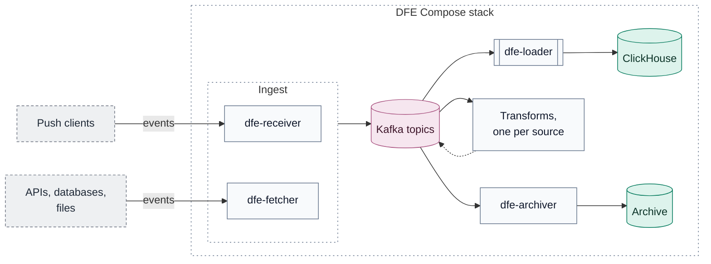
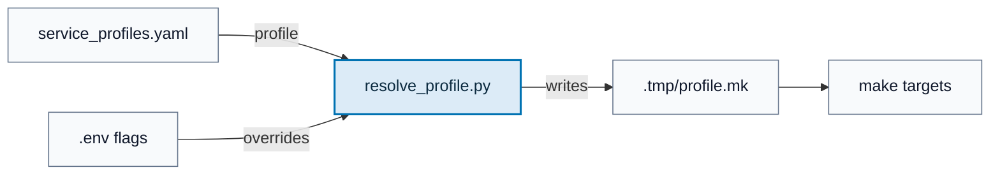
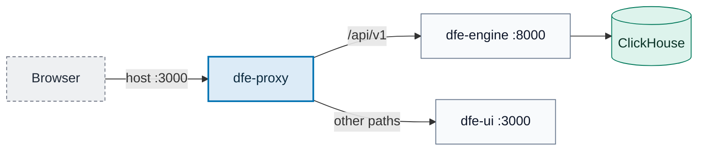
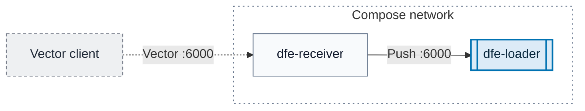

<!--
Project:   dfe-docker
File:      docs/architecture.md
Purpose:   How the DFE Compose stack fits together
Language:  Markdown

License:   BUSL-1.1
Copyright: (c) 2026 HYPERI PTY LIMITED
-->

# How the Compose stack fits together

This repo is **packaging, not product**. It ships a `docker-compose.yml`, the
config files the components mount, and Python helpers that resolve a profile and
pin image versions. It builds no DFE component image. Each release publishes the
dfe-docker image, which sets up a folder that runs the stack, and the compose
files `docker compose -f oci://` runs (`.github/workflows/image.yml`).

When something in the data path is wrong, the fix is almost always in a component
repo, not here.

## Events arrive two ways and leave one

Pushed to `dfe-receiver` or pulled by `dfe-fetcher`, and out through `dfe-loader`
into ClickHouse. Everything between is optional and profile-selected. This diagram shows the running parts of the data path on a Kafka profile.

*Figure 1. L2 Services -- DFE Compose stack. The dotted arrow is a transform writing `<source>_load` back to the broker.* Up: top of dfe-docker. Down: [L4 Detail -- Two listeners on port 6000](#component-repos-and-their-grpc-listeners), [L4 Detail -- Loader topic choice](known-issues.md#a-_load-topic-changes-what-the-loader-reads), [L4 Detail -- Loader and schema checks](troubleshooting.md#events-are-accepted-but-nothing-lands), [L4 Detail -- Topic and dead-letter checks](troubleshooting.md#events-are-accepted-but-nothing-lands).

Push clients are HTTP, Vector, Beats, OTLP, HEC, syslog and flow senders. dfe-engine, the console and Search run beside this path, and Figure 3 shows the console's side.

Transport is a per-profile choice, not a global one. On a `*-kafka` profile the
ingest components produce to a `*_land` topic derived from the event's `_source`.
`config/loader/kafka.yaml` names no topics, so the loader auto-discovers every
topic ending in one of its `routing.topic_suffixes`, `_land` and `_load` by
default. On a `*-grpc` profile there is no broker: the receiver dials
`dfe-loader:6000` directly.

A transform reads `<source>_land` and writes `<source>_load`, and runs on a Kafka profile only. `dfe-archiver` archives each source from its landing topic, and no gRPC profile runs it, so archiving needs a Kafka profile. Once a transform writes `<base>_load`, the loader reads it instead of `<base>_land`: scalo drops `<base>_land` from its subscription once `<base>_load` exists.

dfe-engine creates a transform's table and nothing here provisions it. Create the source before sending it data: a loader that meets rows for a table it has no schema for buffers them, then dead-letters them.

The source NAME propagates character for character. The engine needs a Kubernetes DNS-1123 label (hyphens, never underscores, because a source-bound app deploys one instance called after its source), the receiver substitutes it into `<_source>_land`, and the loader strips `_load` back off for the table. So `filebeat-vector` gives `filebeat-vector_land`, `filebeat-vector_load` and a table name that needs backticks in SQL.

`slim-*` is the core data path alone: receiver, loader, engine, console and dfe-hyperdx. `single-kafka` adds the per-source apps its keys enable ([profiles.md](profiles.md#per-source-apps)) and one archiver. The `-kafka` profiles add the broker ([broker.md](broker.md)). dfe-fetcher runs idle until a fetcher source exists, and no transform starts until a source created through the engine binds one.

## The engine renders each app's config, one instance per source

On Kubernetes an app's chart turns its values overlay into a ConfigMap the pod mounts. Compose runs no chart, so dfe-engine does that step: it merges each instance's overlay over the committed `config/<app>/<transport>.yaml` and writes the app's config file, its programs and its enrichment tables into the `dfe-app-config` volume, one directory per app. Every app mounts that volume read-only at `/etc/dfe/apps`.

The committed file stays the DEPLOYMENT's (brokers, warehouse credentials, the spool) and the overlay wins wherever the two name the same key, so nothing deployment-specific is written into the deploy repo. `resolve_profile.py` turns this on wherever the core footprint runs. dfe-fetcher and the three transforms have no committed file: the overlay is their whole config, and their broker comes from `DFE_KAFKA_BOOTSTRAP_SERVERS` in `.env`.

Nothing restarts a container. A change the running app cannot take in place is reported by the API as `restart required: make apply SERVICES=<app>` and one to its env file as `recreate required:` with the same command. `make apply` creates a per-source container the engine has only just declared, recreates one that exists and removes the container of a source the engine has deleted, which it finds by the `dfe.instance-of` label only generated services have. A delete names no command, so `make apply` with no `SERVICES` does that removal alone and starts nothing.

A source with a transform stops sharing `main_land`: the receiver routes it to `<source>_land`, and only a transform reading THAT topic sees it. So a transform is deployed once per source, as the Kubernetes tier deploys one per Source definition, and its input topic, program directory and output topic all have the name. dfe-engine renders the instance's config into `dfe-app-config`, and `make apply` starts a service that extends the committed `dfe-transform-vrl`, `dfe-transform-vector` or `dfe-transform-elastic`, which have the broker env and nothing of a source's own.

## Two independent selectors decide what runs

Compose profiles select INFRASTRUCTURE. `service_profiles.yaml` selects DFE SERVICES. `scripts/resolve_profile.py` reads the second and derives the first, writing `.tmp/profile.mk` for the Makefile. This diagram shows where the resolver reads from and what reads its output.

*Figure 2. L4 Detail -- Profile resolution. The flags are `DFE_PROFILE` and the footprint toggles such as `DFE_CORE_ENABLED`.* Up: [dfe-docker documentation](README.md).

| Compose profile | Services |
|---|---|
| `clickhouse` | `clickhouse` |
| `kafka-apache` | `kafka-apache` |
| `kafka-redpanda` | `kafka-redpanda` |
| `kafka-ui` | `kafka-ui` (Kafbat) |
| `dfe` | `dlq-init`, `bearer-tokens-init`, the `config-check-<app>` one-shots, archiver, fetcher, loader, receiver, every transform instance |
| `core` | `dfe-engine`, `dfe-hunt-runner`, `dfe-ui`, `dfe-proxy`, the `contract-<app>` one-shots |
| `hyperdx` | `dfe-hyperdx`, `dfe-hyperdx-proxy`, `hyperdx-documentdb`, `hyperdx-documentdb-tls`, `dfe-dashboards` |
| `otel` | `otel-collector` |
| `auth` | the three `oauth2-proxy-*` gates ([auth-profile.md](auth-profile.md)) |

A profile declares its whole footprint through the optional `clickhouse`, `core`, `kafbat`, `hyperdx`, `otel` and `auth` keys, each overridable by the matching `.env` flag. Each service entry names the config file it mounts, which is how one service gets a Kafka config and another a gRPC one without a second compose file.

The `core` footprint is the management plane, independent of transport. `dfe-proxy` gives the console and the engine API one origin, because the console's client calls the engine with a relative `/api/v1/...` base URL. This diagram shows how dfe-proxy splits that origin.

*Figure 3. L4 Detail -- One console origin. The ports in the boxes are container ports.* Up: [dfe-docker documentation](README.md).

## dfe-engine owns the schema and the topics, and starts first

Nothing here provisions a ClickHouse table or a Kafka topic. `dfe-engine` ships `/app/schemas` inside its own image, applies every object and every bootstrap topic from that manifest at startup, and reports healthy only once that pass converged. `dfe-schemas` rides inside the engine image, so there is no separate schema pin here and a schema change is a `dfe-engine` release. The ClickHouse service mounts only server settings from `config/clickhouse/`. A DDL file or a topic-creating step appearing in this repo is wrong by construction, and `scripts/tests/test_engine_only_schema_control.py` fails the build on one.

`compose/one-shots.yml`, which `docker-compose.yml` includes, holds every container that runs once and exits: dlq-init, bearer-tokens-init, the `contract-<app>` emitters, dfe-dashboards, hyperdx-documentdb-tls and a `config-check-<app>` for dfe-archiver, dfe-loader and dfe-receiver. Each config check runs its app's own `config-check` with the image, environment and config file the app is about to start with, once the engine has rendered that file, and the app starts only after it passes. A broken config therefore stops `make up`, `make dev`, `make ci` and `make apply` with the app's own error instead of a restart loop. A key the app does not know still passes, because the apps ignore unknown keys.

The apps then wait on `depends_on: dfe-engine: service_healthy`, because healthy means their tables and topics exist. A loader started first holds messages pending-schema and dead-letters them, which reads as data loss and is really start ordering.

Each limit tier extends `base` in `compose/base.yml`, and its `dns_search: ["."]` clears the search domain the host passes into every container. A bare name with no alias (`kafka` on a stack without a broker) then fails to resolve instead of reaching a host on that domain.

## Component repos and their gRPC listeners

Dev builds fetch source into a managed git cache, or from your own checkouts when
`DFE_SRC_ROOT` is set -- see
[developing.md](developing.md#some-from-source-the-rest-pinned).

| Repo | Language | Role | Profile |
|---|---|---|---|
| `dfe-receiver` | Rust | Push ingest. HTTP `:8080` published, Vector gRPC `:6000`, OTLP, Beats, HEC, syslog and flow published once their port key is set | `dfe` |
| `dfe-fetcher` | Rust | Pull ingest from REST APIs, databases and files | `dfe` |
| `dfe-loader` | Rust | Writes ClickHouse and hosts `scalo.transport.v1.Transport/Push` | `dfe` |
| `dfe-archiver` | Rust | Archive sink (filesystem, S3, MinIO, GCS, Azure Blob) | `dfe` |
| `dfe-transform-elastic` | Rust | Beats and Elastic Agent pipelines compiled to Rust, one transform selected per instance by `source.name` or, in agentless mode, detected per event | `dfe` |
| `dfe-transform-vector` | Rust | Vector.dev subprocess wrapper, Kafka to Kafka | `dfe` |
| `dfe-transform-vrl` | Rust | Embedded VRL transform engine, deployed once per source that has a transform | `dfe` |
| `dfe-engine` | Python | Config and schema API, and the schema authority | `core` |
| `dfe-ui` | TypeScript | The DFE console | `core` |
| `dfe-hyperdx` | TypeScript | The console's Search, a fork of HyperDX. Repo and published image are both `dfe-hyperdx` | `hyperdx` |

dfe-transform-vector mounts `resources/enrichment/` at `/etc/dfe-transform-vector/data`, where its bundled filebeat pipeline reads `timezones.csv`. dfe-transform-elastic compiles its transforms in, and the engine uploads the enrichment tables a dfe-transform-vrl program reads, so neither mounts them. `make test-source` drives the filebeat, Vector and Elastic cases through every hop. dfe-transform-vector's one port serves everything: the wrapper scrapes Vector's `internal_metrics` off its `prometheus_exporter` on loopback and registers the samples on scalo's own recorder (dfe-transform-vector#70), so `vector_*` reads on its metrics port and rides the OTLP push. The exporter's 9598 is not published.

Two gRPC listeners share port 6000, and they are not the same thing. This diagram shows both on a `*-grpc` profile.

*Figure 4. L4 Detail -- Two listeners on port 6000. The dotted arrow is off until `config.grpc.enabled` is set.* Up: [L2 Services -- DFE Compose stack](#events-arrive-two-ways-and-leave-one).

| Container port | Host port | Owner | Protocol | Audience | Binds |
|---|---|---|---|---|---|
| 6000 | none, until `DFE_RECEIVER_GRPC_PORT` is set | dfe-receiver | Vector protocol, an ingest source that listens only once `config.grpc.enabled` is set through the engine | external clients | `DFE_INGRESS_BIND_HOST` (`0.0.0.0`) |
| 6000 | none | dfe-loader | `scalo.transport.v1.Transport/Push`, internal transport | dfe-receiver, on a `*-grpc` profile | the compose network |

Every Push listener in the suite answers on 6000 and dfe-engine compiles each sender's endpoint against that port. The receiver's listener is meant to be reachable from outside the stack. The loader's is not, so it publishes no host port.

`dfe-transform-splack` and `dfe-transform-wasm` have repos but no service here,
so this stack cannot run them.

## Where this differs from Kubernetes

Kubernetes is the primary DFE path. Compose is supported for small environments
and is not co-equal -- if both would work, choose Kubernetes. What makes Compose
safe to deploy is that it consumes the SAME image from the SAME registry, pinned
from the same stack SSoT, so both run identical digests.

Three deliberate asymmetries:

- An operator applies a new source. Both tiers run a fetcher and a transform per source. On Kubernetes Argo creates the new Deployment. Here the engine declares the instance and reports `make apply`, which starts it. After deleting a source, run `make apply` with no `SERVICES` to stop its transform, because the delete names no command and the container runs until an apply or a restart removes it. `make ps` warns about any it finds.
- No edge authentication. Envoy fronts both tiers, but its OIDC filters stay unconfigured here, because Docker mode can never assume an issuer exists. The engine API still needs a login per route, which the proxy neither adds nor removes. The opt-in `auth` profile gates the infra UIs alone ([auth-profile.md](auth-profile.md)).
- Self-monitoring collects differently. Container stdout reaches the collector through Docker's `fluentd` log driver rather than a DaemonSet filelog receiver, and of the host's own metrics only its CPUs are collected. See [observability.md](observability.md).

## Related

- [operating.md](operating.md) -- access, exposure, limits
- [secrets-and-storage.md](secrets-and-storage.md) -- secrets, volumes, retention
- [deploying.md](deploying.md) -- the dial, pinning, upgrades
- [observability.md](observability.md) -- health, self-telemetry, the self test
- [developing.md](developing.md) -- dev mode, profiles, proving the pipeline
