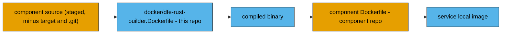

<!--
Project:   dfe-docker
File:      docs/developing.md
Purpose:   Using the Compose stack as a local test rig for DFE component work
Language:  Markdown

License:   BUSL-1.1
Copyright: (c) 2026 HYPERI PTY LIMITED
-->

# Developing against the stack

This applies to you if you are working on a DFE component and need a stack to
test it against.

You do not develop *this* repo to change component behaviour -- it is packaging.
What you get from it is a running pipeline that either pulls published images or
compiles your local component source, plus two harnesses that prove events
actually traverse it.

Read [architecture.md](architecture.md) first if you have not: which services
exist, and how a profile decides which of them run.

## Prerequisites

| Need | For |
|---|---|
| Docker and Docker Compose v2 | everything |
| Python 3 | the helper scripts under `scripts/` |
| uv | `make sources`, `make rules`, `make hunts`, `make events`, `make orgs`, `make accounts`, `make demo`, `make test-e2e`, `make test-resilience` and `make test-flows` only. It installs the PyYAML and Playwright those scripts declare inline, hash-checked against the `<script>.lock` beside each |
| ruff | `make check-python` only |
| pytest | `make check-tests` only (`uvx` fetches the pin if you have it) |
| git, to clone the public hyperi-io repos (or `DFE_SRC_ROOT` checkouts) | `make dev` |

## First run

```bash
make init                  # generate .env and env/<service>.env
make stack VERSION=X.Y.Z   # pin the image versions
make up                    # pull and start, self test, then print the login
```

`make init` copies `.env.example` to `.env` and every `env.example/<service>.env`
to `env/<service>.env`. Existing files are never overwritten, so it is safe to
re-run. It does two things beyond the copy:

- **Generates secrets.** Each gets a random value in its file: `.env`, `env/engine.env`, `env/ui.env` or `env/hyperdx.env`. An existing file that predates a key is topped up.
- **Reports drift.** The copy is one-shot, so a `.env` made months ago never
  learns that `.env.example` grew a setting. A re-run lists the keys yours is
  missing and stops there -- editing your `.env` is yours to do.

`make stack VERSION=X.Y.Z[-rc.N]` writes the `*_VERSION` pins into `.env` from the
DFE stack SSoT. It uses a local dfe-infra checkout only when `DFE_INFRA_DIR`
names one (`scripts/dfe-stack render --target docker --stack VERSION`), and
otherwise does an `oras pull` of `ghcr.io/hyperi-io/dfe-stack-manifest:VERSION`.
If neither is available it fails loudly -- there is no silent `latest`. Only
`*_VERSION` keys are rewritten; your ports, hosts, credentials and profile
survive the merge.

`make stack VERSION=latest` pins the newest published stack (`rc` ranks
pre-releases too). It reads only the public OCI registry, needs no credential,
and records the word in `.env`, so a re-run moves forward -- `make modes` reports
it as LATEST, and it is not a deploy.

`DFE_STACK_REPIN_IMAGES=1` adds the development-currency step: every DFE image is
repinned at the release its GitHub repo marks Latest (`rc`: the newest release of
either kind), through a `gh` login. The pins still carry digests, but the combination is one nobody
certified.

Skipping `make stack` is not a soft failure. Nearly every image pin uses
`${VAR:?...}`, so an unpinned checkout aborts the compose command with a message
naming the key.

## Logging in the first time

The deploy mints the credentials, the engine never ships one. `make init` writes
two random passwords into `env/engine.env` and prints neither.

| Target | What it does |
|---|---|
| `make init` | mints `DFE_AUTH_LOCAL_ADMIN_PASSWORD` (the `admin` login) and `DFE_AUTH_BREAKGLASS_PASSWORD` (the `breakglass` recovery login) |
| `make up` | starts the pinned stack, runs the self test, then prints the access summary with the login |
| `make creds` | prints that summary again, any time |

The password prints to a **terminal** only. Redirect it, pipe it, or run it in
CI and you get the `env/engine.env` key holding the value instead. `DFE_CREDS_SHOW=0` does
the same on a terminal. `make ci` does not call it at all, which is why `make up`
exists as the operator-facing name for the same start.

`make creds` is also the line the engine puts on its own login page while
first-run setup is incomplete, so an operator who lands there with no password is
one command from having one.

The two accounts are durable in different ways, deliberately. The engine issues `admin` from `env/engine.env` with a forced change at first login, which `make post` makes and records back in `env/engine.env`. A new value there is a rotation. The last issued value or the account's current password re-issues nothing. `breakglass` is hashed into the engine's deploy repo on its first boot and the variable is ignored from then on, so it still works when the engine, the UI and `env/engine.env` are all gone. `make creds` says where its password lives rather than printing it. Once the setup wizard has retired `admin`, `make post` skips the checks that log in and still proves the rest.

The engine **refuses to start** on an empty or `changeme`
`DFE_AUTH_LOCAL_ADMIN_PASSWORD` unless `DFE_ENV` names a dev posture. `make
check-compose` asserts the compose file never hands it one, so that is caught
before a container crash-loops.

`make dev` is the exception and says so: it writes the known default password into `env/engine.env` and `DFE_ENV=dev` into `.env`, because a dev loop should not need a lookup to log in. The engine accepts the default in that posture and makes the admin replace it at first login. A `.env` already on a dev posture keeps the replacement `make post` recorded. It **refuses** (exit 2) to run when `.env` already declares a non-dev `DFE_ENV`: downgrading a deployment's posture and overwriting its admin password is not a build target's call. Start that stack with `make up`.

When it does rewrite, it copies each file it replaces to `<name>.bak-<utc>` beside it first, mode 0600, then prints the paths: a minted password is gone once overwritten. A run with nothing to change writes neither.

`AUTH=real` is the same local build against a deployment's authentication flow,
for when the login is the thing under test. It mints a password and writes
`DFE_ENV=production`, leaving either alone where it is already real, so it never
refuses. `make creds` reads the password back.

```bash
make dev              # local images, DFE_ENV=dev, known default password until replaced
make dev AUTH=real    # local images, minted password, DFE_ENV=production
```

## Dev mode compiles your source; registry mode pulls GHCR

```bash
make dev    # build :local images from local component source, then start
make ci     # pull the pinned GHCR images, then start
```

`make dev` relies on `docker-compose.override.yml`, which is committed and
auto-loaded by Compose with no flags. It repoints each DFE service at
`<service>:local`. `make ci` passes `-f docker-compose.yml` explicitly, which
skips the override and therefore uses registry images only.

Both start targets run `make env-files` first: it asserts every
`env.example/<service>.env` has a counterpart in `env/`, runs `make init` for the
ones a release added, and fails only if one is still missing. It warns, never
edits, when a template gains a key inside a file you already have.

`scripts/build_dev_images.py` builds the `:local` images in two stages for every
Rust component:



**This repo owns the build; the component owns the runtime.** The shared builder
image is where the toolchain, the Confluent `librdkafka-dev` and the pinned Rust
version live, so every component compiles the same way. Packaging then goes
through the component's own committed `Dockerfile` with the binary in context, so
the runtime image you test is the one the component ships.

`dfe-engine`, `dfe-ui` and `hyperdx` skip the builder entirely and build straight
from their own Dockerfile.

A service that is not a locally buildable DFE component (ClickHouse, the broker,
`kafka-ui`) is skipped with a message rather than failing the build.

A service that runs a component's image under another name follows it:
`dlq-init` runs the archiver image, `dfe-hunt-runner` and `dfe-dashboards` the
engine image. The map is `IMAGE_CONSUMERS` in `scripts/build_dev_images.py`, and
`make check-compose` asserts the override covers all of it.

The `contract-<app>` one-shots are the deliberate
exception: they emit an artefact of the PINNED release and stay on the registry
pin while a local build runs beside them, because moving them onto `:local` would
make a core-only profile compile the Rust components to emit a few files.

Two of them can start without their component (`IMPLICIT_CONSUMERS`, same file):
`dlq-init`, which a `depends_on` starts under every Rust app, and
`dfe-dashboards`, which starts with `hyperdx` whether or not the engine runs.
`make dev` builds the archiver or the engine for them even on a profile that runs
neither, or the override points them at a `:local` tag the run never produced.

### Some from source, the rest pinned

```bash
make dev LOCAL="dfe-engine dfe-ui"   # build these two; everything else from GHCR
```

The build writes `docker-compose.local.yml` (not committed) repointing only the
named components and the services sharing their image at `:local`, and compose
runs with explicit `-f` files so the all-local override stays out. `SERVICES`
still filters what starts, `LIVE=1` still layers the engine bind-mounts, and a
name outside the resolved stack is a hard error.

### Where it looks for your source

Source comes via git, never an assumed directory layout:

- **Default -- the managed cache.** The builder clones each component repo from
  `DFE_SRC_REMOTE` (default `https://github.com/hyperi-io`) into
  `DFE_SRC_CACHE` (default `~/.cache/dfe-docker/src`) and builds the commit
  `DFE_SRC_REF` resolves to (default `main`). Re-runs fetch and re-checkout, so
  the cache tracks the ref. The cache is tool-managed: a dirty checkout there
  fails the build rather than silently building someone's stray edits.
- **Local work -- set `DFE_SRC_ROOT`.** Point it at the directory holding your
  `dfe-*` checkouts (in `.env` or the `make` command line) and the builder uses
  those working trees as they stand, uncommitted changes included. This is the
  explicit replacement for the old sibling-checkout assumption -- nothing is
  inferred from where this repo happens to live.
- **Live engine edits -- `make dev LIVE=1`.** Layers `docker-compose.live.yml`,
  which bind-mounts `dfe-engine/config` and `dfe-engine/schemas` from
  `DFE_SRC_ROOT` so engine config edits land without a rebuild. It hard-fails
  when `DFE_SRC_ROOT` is unset, because a defaulted path would silently mount
  empty directories over the engine's own config on any machine without that
  layout. Note that with `DFE_SRC_ROOT` set, EVERY active component builds from
  those checkouts -- live mode is "build and mount my local source", not an
  engine-only switch.

`make stack`'s local-render path is explicit the same way: it uses a dfe-infra
checkout only when `DFE_INFRA_DIR` names one, and otherwise pulls the signed OCI
stack manifest.

### Console edits without a rebuild

```bash
make dev LIVE_UI=1   # dfe-ui runs `next dev` over $DFE_SRC_ROOT/dfe-ui
```

`LIVE_UI=1` layers `docker-compose.live-ui.yml`, which runs dfe-ui as `next dev` over your checkout instead of building its image. It still sits behind dfe-proxy on `DFE_UI_PORT`, so login, the engine API and the HyperDX embed work as they do on any stack. A saved edit reaches the browser through hot reload, which rides the websocket upgrade the proxy already allows. `docker compose logs -f dfe-ui` shows the dev server's output.

The first start installs dependencies into the checkout, about 1 GB of yarn cache under its gitignored `.yarn/`; later starts install from that cache in seconds. Each route compiles on its first hit. The login page compiles as the dev server starts, so the first visit stays inside dfe-proxy's 15s route timeout.

Next.js only accepts hot-reload connections from `localhost` or the host it serves on. The console does not finish loading without one. Live mode serves on the hostname `DFE_EXTERNAL_ORIGIN` names, so the console works there and on `localhost`. An origin that is an IP address cannot be served on by name, so browse that stack by hostname or on `localhost` instead.

`make apply SERVICES=dfe-ui DEV=1 LIVE_UI=1` swaps a running dev stack's console into live mode and leaves every other service running. A stack started with `LOCAL` takes the same `LOCAL` with dfe-ui left out. The same command without `LIVE_UI` and with the stack's own `LOCAL` runs `dfe-ui:local` again, which exists only if an earlier `make dev` built it.

The dev server answers its source-map and stack-frame endpoints without a login, so with `DFE_BIND_SCOPE=all` anyone who can reach the console port can read the console's source. Use live mode on a network you trust. `LIVE_UI` only applies to `make dev` and `make apply DEV=1`, never to `make ci` or `make up`.

The container runs as your user and writes `node_modules` and `.next` into the checkout, so stop any `next dev` you run there yourself first. Keys the stack does not set are filled from the checkout's `apps/dfe-core-ui` env files (`.env`, `.env.local` and `.env.development*`). `LOCAL` must not name dfe-ui alongside it.

Live mode needs a Linux host: on macOS the container's install would swap the native modules your host's `node_modules` relies on. On a Mac, run `next dev` on the host against the stack's engine instead, on port 5173 since dfe-proxy holds 3000, as dfe-ui's [local development guide](https://github.com/hyperi-io/dfe-ui/blob/main/docs/local-development.md) describes.

## Picking a profile

`service_profiles.yaml` decides which DFE services run and which config each
mounts. `active_profile` is the default; `DFE_PROFILE` overrides it for one
invocation.

Every profile is a whole stack named `<tier>-<transport>`: `slim` runs the core data path, `single` adds the per-source apps, over `grpc` or `kafka`. Only `single-kafka` runs the archiver. Which profile runs what: [profiles.md](profiles.md). There is no `scale` tier: Compose cannot run an HA broker or a ClickHouse cluster.

```bash
DFE_PROFILE=single-kafka make dev     # override the profile
KAFKA_BACKEND=apache make dev         # Apache Kafka instead of Redpanda
DFE_CORE_ENABLED=false make dev       # skip engine, UI, proxy and HyperDX
DFE_CLICKHOUSE_ENABLED=false make dev # no warehouse container (external instance)
DFE_HYPERDX_ENABLED=false make dev    # skip the HyperDX observability stack
make dev SERVICES="dfe-loader"        # start a subset of the resolved profile
```

Those four flags mirror the `clickhouse`, `core`, `kafbat` and `hyperdx` keys a
profile may declare, and they win over it -- `.env` is what a deploy writes, the
profile is the committed shape. Leave them unset and the profile decides.

Two of those need a warning.

`DFE_CORE_ENABLED=false` drops `dfe-engine`, and **dfe-engine is the schema
authority** -- nothing else provisions the ClickHouse tables or registers the
schemas the loader pre-warms. Without it the loader holds messages pending-schema
and dead-letters them, so the data path looks broken when it is really unprovisioned.
Use it when you are working on the UI or proxy against tables that already exist,
not on a fresh stack.

`make dev SERVICES="..."` no longer starts a subset on top of a running stack:
`dev` depends on `down`, which now tears down every profile first.

A name in `SERVICES` that is not part of the resolved stack is a hard error, not a silent no-op. Adding a config to a profile that does not exist on disk is caught too: `resolve_profile.py` validates every `config_path` before writing `.tmp/profile.mk`.

## Seeding a starter set

`make sources`, `make rules` and `make hunts` create a starter set of detection content on a running stack through the engine API, from the request bodies in `resources/seed/`. `make hunts` also creates the rules, because the engine refuses a hunt whose rule does not exist. A rule over an undeployed source reads nothing until its source is deployed. A hunt whose table does not exist yet is not created, because the hunt runner would fail on every run. `make hunts` creates it once `make sources` has made the table, on a profile that runs the source.

| Target | What it creates |
|---|---|
| `make sources` | `aws-cloudtrail`, `aws-guardduty` and `aws-securityhub` (each polled by its own dfe-fetcher instance) and `syslog`, which takes any record sent to the receiver with `_source: syslog`. Each lands in `dfe.<source>`. Sources a profile cannot run are skipped, so [`slim-grpc`](profiles.md#which-profile-runs-what) gets `syslog` alone |
| `make rules` | `aws-guardduty-high-severity`, matching a GuardDuty finding rated 7 or above |
| `make hunts` | That rule, and the hunt `aws-guardduty-high-severity` once `dfe.aws-guardduty` exists, running it every five minutes into `dfe.detection` |
| `make events` | Two fake GuardDuty findings from `resources/seed/events/`, rated 8.0 and 2.0, so the hunt's next run detects the first and leaves the second |
| `make orgs` | The org `acme`, for records carrying the tenant id `acme` |
| `make accounts` | Those orgs, then the admin account `ops` in `dfe-admins` |

`make events` posts its records to dfe-receiver tagged with the source each file is named for, which routes them over the stack's transport, Kafka or gRPC. It waits until the source's table holds them and fails if they do not arrive, so it needs the source deployed by `make sources`, dfe-receiver and an engine that renders the apps' config. It skips the records of a source `make sources` skipped. It sends the records again on every run and needs no login. The hunt that finds them runs in dfe-hunt-runner.

A run of any other target creates only what the engine lacks and leaves an object it already holds as it is, so editing a seed file changes nothing on a stack that has the object. Delete the object and the next run creates it from the file. A source is deployed as it is created, which creates its table. A source the engine holds undeployed is deployed. `make sources` ends by asking the engine to bring every app in step with the sources, which retries a deploy whose apps did not take it.

Every target but `make events` logs in as `admin` with `DFE_AUTH_LOCAL_ADMIN_PASSWORD` from `env/engine.env` and replaces an issued password as `make post` does. Once the setup wizard has retired `admin`, they ask at the terminal for an account that can write what the target seeds. They ask once per run and store the login nowhere. Without a terminal they stop. An account still on the password it was issued has to change it in the console first.

Each fetcher source runs in its own container, which the engine declares but does not start. The deploy prints the command it needs, such as `recreate required: make apply SERVICES=dfe-fetcher-aws-guardduty`. Until then `make post` leaves the instance out of its metrics check. The fetchers read `AWS_ACCESS_KEY_ID` and `AWS_SECRET_ACCESS_KEY` from `env/fetcher.env` and cannot fetch until both are set. Compose reads that file only when it creates a container, so set the keys before `make apply`, or run it again after setting them.

## Seeding orgs and accounts

`make accounts` creates the orgs first, because the engine refuses an account naming an org it does not hold. An account file carries no password. A new account gets a 24-character one, recorded in `env/engine.env` as `DFE_SEED_ACCOUNT_<USERNAME>_PASSWORD` before the account is created. `make creds` hands it over the way it hands over `admin`. A volume wipe deletes the orgs and accounts, so run both targets again after one. An account comes back on the password already recorded.

## Proving the pipeline works

Two harnesses, different scopes. Both inject uniquely marked events and read the
marker back out of ClickHouse, so neither can pass on a stack that started but
does not move data.

### Power-on self test -- runs whether you ask or not

`make dev` and `make ci` finish by running `scripts/post.py`. It injects three marked events into the receiver of the **resolved profile** and waits for those exact rows in `dfe.main`.

```bash
make post                        # against an already-running stack
DFE_POST_ENABLED=false make ci   # opt out
```

What a pass proves: an event put in one end came out the other, on whichever
transport is active. What it also catches: a secret still sitting at its committed
default -- it fails before injecting anything and tells you to run `make init`.

Two honest limits. On a loader-only profile it **skips** with a stated reason,
because there is no ingest edge. And if rows arrive but no marker can be read, it
**fails** rather than claiming success -- a schema without `_tags` makes the check
unverifiable, which is not the same as passing.

### End-to-end suite -- one stack per test

```bash
make test-e2e
make test-e2e E2E_TESTS="simple-receiver-to-loader-grpc simple-receiver-to-loader-kafka"
```

`tests/e2e/e2e-tests.yaml` is the definition. A `global:` block sets the data file
(`tests/e2e/data/events.jsonl`), the mode (`ci` builds `--no-cache --pull`; `dev`
also loads the override file) and `persistent_services` -- only ClickHouse
survives between tests, so each test runs its own config against a fresh broker.
Each entry under `tests:` names a `service_profiles.yaml` profile, optionally
`expected_topics` (created and cleaned per run, then verified) and
`config_overrides` keyed by service name.

The runner brings ClickHouse and `dfe-engine` up first and gates on the engine's
health, because the engine provisions `dfe.main` and registers the schemas the
loader pre-warms. Then it asserts **two** things per test: the row-count delta
from a per-test baseline, and that those rows carry this run's marker in `_tags`.
The delta alone would pass on somebody else's rows; the marker alone would not
notice a partial load. A marker column it cannot locate is reported, never
silently treated as a pass.

Every profile declares `otel`, which adds a third assertion: the stack's own telemetry landing fresh in the `dfe.otel_*` tables. `expected_http` adds a fourth, a status and optional body check per URL. It makes `complete-single-node-stack` a whole-stack test rather than a data-path one.

An archiver that subscribes to the test's landing topic and archives to a
`file://` destination must also write a file there during the test, new or grown
since a baseline taken before the send. The archive volume outlives the stack, so
files from an earlier run never count.

The data file goes to the ingest edge 16 requests at a time. The receiver answers each request once the loader has flushed it, so one at a time costs a flush per event.

The suite stops whatever stack the project is running, so it reads the project first, along with the config hash compose gives each service from its files and environment at that moment. On every way out, a failure or a SIGTERM included, it starts each service that was running or had run to completion again, from the compose files it was started from. A last verdict fails if one comes back on a config hash other than the one compose gave at the start.

A container keeps the hash it was created with, so one whose `.env` or compose file has changed since is named in a warning and comes back on the current config. `make ci` leaves the engine that way whenever `make post` rotates the admin password into `.env`. Run the suite as the user that started the stack: `make` writes that user's GID into the engine's config, and under console TLS its UID and GID into both proxies', so another user shows up in that warning.

Under [console TLS](configuration.md#console-tls-opt-in) each test's stack chains the fragments `make ci` does, the exposure opt-outs and container logs included. The console checks go to `https://<DFE_EXTERNAL_ORIGIN host>:<DFE_UI_PORT>` and verify its certificate by chain and name, against `DFE_PROXY_CA_BUNDLE` when a private CA signed it. A certificate that does not verify fails the check with the variable to change.

Two things about the runner worth knowing before you debug it:

- **It waits on named services, never on a whole profile.** `docker compose up
  --wait` counts a container that EXITS as a failure even on exit 0, and the
  topic-init services are one-shots that must exit. Waiting on the profile sweeps
  them in and fails regardless of broker health.
- **It deletes the `_load` sibling of every expected `_land` topic before each run.** Broker volumes outlive containers, so a `main_load` left by any transform run suppresses `main_land` for every non-transform loader thereafter. See [known-issues.md](known-issues.md#a-_load-topic-changes-what-the-loader-reads). Deleting it per run makes a run depend on the test definition, not on broker history.

### The dfe-ui Playwright suite -- one target on, one off

The suite seeds its fixtures through the engine's `/api/e2e` routes, which exist only with `DFE_E2E_SERVER=true`, and its seeders refuse anything but `DFE_ENV=test`.

```bash
make e2e-posture         # DFE_ENV=test, DFE_E2E_SERVER=true, the shipped admin password
make e2e-posture-check   # exit 1 naming what is missing; the suite runs this first
make e2e-posture-off     # put back the .env from before
```

`e2e-posture` copies the `.env` it replaces to `.env.pre-e2e` (0600) the first time, and `e2e-posture-off` restores it. It refuses (exit 2) on a `.env` that names a deployment, since it writes the shipped admin password over the real one. The engine reads `.env` when it starts, so recreate the stack after either switch.

### Rules and hunts -- exactly the matching events

```bash
make test-e2e E2E_TESTS=rules-and-hunts
```

A test with a `detection:` block makes the `e2e` organisation when absent, a rule (`POST /rules`) and a one-minute hunt for it over `dfe.main` into `dfe.detection` (`POST /hunts`), and the runner must commit its first window. It sends the `matching` events and `other` near misses, with `"_org_id": "e2e"`, as the runner reads only the org's rows. Its receiver config, `tests/e2e/configs/receiver-e2e-org.yaml`, keeps a sender's `_org_id` and binds the HTTP listener to `default` and `e2e`, so the field survives the receiver's org clamp. It queues a run (`POST /hunts/{name}/run`) and waits for `last_run` to pass the last event's load time.

The hunt's rows must name, by `matched_uuid`, every landed `matching` row once and no `other` row, under the rule and severity the test gave. The hunt, rule and any org it made are deleted and asserted gone. The rows stay, tagged with the run marker.

The `core` footprint starts `dfe-hunt-runner`, as `make dev` does. On a profile with it off the test skips with that reason, and a skip fails the run.

### Search to rule to hunt -- the console path

```bash
make test-e2e E2E_TESTS=search-rule-hunt
```

A `detection:` block carrying `from_search` makes its rule the way an analyst does, in a browser. It adds HyperDX to the stack, signs in to the console as the stack's admin and opens Observe search on `main`. The search bar gets the block's `search`, held to the run's marker, and the side panel picks its `filter`. Then Create Rule, and the rule page it opens.

The stored rule has to scan `dfe.main` with no SQL errors and a WHERE that carries both filters. The hunt over it is added and triggered from the console's own form, and the verdict is the rules-and-hunts one: every matching event detected once, no near miss. Each filter alone lets a near miss through, so a filter lost between the search and the rule fails it.

The side panel only offers values rows already hold, so both event sets are sent once before the search. The hunt's first window can reach those rows, so their near misses are judged too, and their matches are not.

The console holds every page behind its setup wizard, so the test first makes the `e2e` organisation and one user of the deployment's own (`e2e-analyst`), as the wizard would, and deletes whichever of the two it made once the hunt and the rule are gone. uv installs Playwright from the script's inline metadata, and the test drives Google Chrome (`uvx playwright install chrome` where it is absent). `DFE_E2E_HEADED=1` shows the browser, and `DFE_E2E_SHOTS_DIR` keeps the step screenshots, which otherwise go to a new temporary directory named in the log.

Under console TLS the suite first verifies the console certificate itself, then pins Chrome to that certificate's public key, because Chrome takes no CA bundle.

### Outage tests -- a service stopped under load

```bash
make test-resilience
make test-resilience E2E_TESTS="clickhouse-outage loader-outage-grpc"
```

Opt-in: `make test-e2e` never runs these, and refuses one named in `E2E_TESTS`.
An `outage:` test sends steady load and, once its first records land, stops the
named service for `seconds`, starts it again in a `finally`, and keeps sending
for 30 s. It then asserts every other DFE service ran straight through (same
pid, no restart, no die or OOM event), the receiver answered every request (a
refusal such as 503 passes, silence fails), every accepted record landed, and on Kafka
every consumer group is back at zero lag. They stop services, so they never run
in `make post` either.

An outage's `method` is `stop` by default, a graceful stop that lets the service drain what it holds. `method: kill` sends SIGKILL and a crash gets no drain, so a record the service held in memory survives only if its acknowledgement was held until the next hop had it. The `*-kill-*` tests kill the loader and receiver on Kafka and the loader and vrl transform on direct gRPC. They pass only when every record answered 2xx lands, duplicates counted but allowed. Where the killed service is the receiver itself, a request in flight while it is down may go unanswered but silence outside that window still fails.

A kill that catches nothing in flight proves nothing about a crash, so a kill test fails on it. For the receiver or a gRPC hop that means no request out at the instant the container exited. For a Kafka consumer it means nothing its group had left uncommitted just before the kill. The kill tests raise the load with `workers` and `interval` (the default is 4 workers each waiting 0.5 s) so that a kill lands with records in flight.

### Post-deploy source test -- what an operator does first

```bash
DFE_INFRA_DIR=../dfe-infra make test-source
DFE_INFRA_DIR=../dfe-infra make test-source SOURCE_ARGS="--case cloudwatch --aws-service cloudtrail"
DFE_INFRA_DIR=../dfe-infra make test-source SOURCE_ARGS="--case elastic"
DFE_INFRA_DIR=../dfe-infra make test-source SOURCE_ARGS="--case vector"
```

Above, sources come through the API. This one creates one in the console, attaches a transform, deploys it, feeds it real data and reads the rows back, driving a browser to do it. The runner is dfe-infra's (`scripts/acceptance/source/run.py`), the same one `dfe-ops acceptance --suite source` calls for Kubernetes.

`scripts/test_source.py` supplies what this repo owns: the published ports, the archiver container, the admin login from `.env` and `make apply` for each service the engine says must restart, which is what creates the source's own transform container. Run `make test-source DEV=1` against a `make dev` stack so that apply keeps the local images. `SOURCE_ARGS` reaches the runner untouched (`--keep`, `--per-module`, `--headed`).

Beyond a running stack it needs `DFE_INFRA_DIR` (the runner), `DFE_ENGINE_REPO` and `DFE_TRANSFORM_VRL_REPO` (the corpus wrapper, the bundled pipeline), a dfe-transform-vector checkout for the vector case (`DFE_TRANSFORM_VECTOR_REPO`, else the one beside the engine repo) and an interpreter carrying Playwright (`DFE_ACCEPTANCE_PYTHON` where the system one is externally managed). The cloudwatch case polls a real AWS upstream and writes nothing to it: put the two `AWS_*` credentials in `env/fetcher.env` and `DFE_AWS_REGION` in `.env`.

Every step is a report row and a screenshot under `--shots-dir` (`.tmp/source`).
A step the console cannot do falls back to the engine API and says so, because
that is a finding about the console rather than about the pipeline.

`make proof` runs the filebeat and vector cases on every stack version, each transform checkout cloned at the tag the stack pins, so a pin of either transform is proven through its data path.

## Static checks

`make check` runs what CI runs, so a green local run means a green pipeline.

| Target | What it does |
|---|---|
| `make check-compose` | `docker compose config` on the registry, dev, live and `LOCAL=` paths, against both Kafka backends, plus the CPU floor and override-coverage assertions |
| `make check-hardfail` | asserts an unpinned checkout refuses to resolve instead of pulling `latest` |
| `make check-dockerfile` | hadolint on `docker/dfe-rust-builder.Dockerfile` |
| `make check-docs` | asserts every relative link across the README and the five docs resolves |
| `make check-proxy` | `envoy --mode validate` on both proxy configs and their console TLS variants, on the Envoy the stack pins |
| `make check-python` | `ruff check` and `ruff format --check` on `scripts/` |
| `make check-tests` | `pytest scripts/tests` -- unit tests over the credential helpers |
| `make check-locks` | `uv lock --check` on each script that declares packages inline, so a pin moved without `uv lock --script <script>` fails here rather than mid-suite |

`check-compose` is hermetic: it reads the mandatory `${VAR:?}` keys out of the
compose file and substitutes placeholders, so it reads neither the stack SSoT nor
the registry. It validates compose *structure*, not that any digest
resolves. It also refuses a `DFE_SERVICE_CPUS` under 2.0 on any service that gates
on `/readyz` -- see [operating.md](operating.md#dfe_service_cpus-has-a-floor-of-20-and-it-is-not-about-speed)
for why a lower ceiling takes health endpoints dark.

`check-docs` resolves the file half of every relative link; it does not fetch
external URLs and does not check `#anchors`, so a live file with a stale anchor
still passes.

`check-dockerfile` pulls the pinned hadolint image, `check-tests` resolves the
pinned pytest through `uvx` and `check-locks` the pinned uv, so those want a
network the first time. The rest need none.

`check-proxy` validates on the Envoy in `DFE_PROXY_VERSION`. With that unset it asks `scripts/stack.py --print DFE_PROXY_VERSION` for the one the stack at `VERSION` pins, falling back to `deployment.example.yaml`'s `version.pin`. That lookup reads the stack manifest anonymously through `oras`. The check mints a throwaway P-384 certificate with the host's `openssl` for the TLS variants.

## Port collisions on a shared dev host

The broker publishes one host port, `19092`. A shared dev box very often already
runs a Kafka or Redpanda on `9092`, and that does not clash, because the in-network
listener `kafka:9092` is not published. If something holds `19092`, move it:

```bash
make test-e2e KAFKA_PLAINTEXT_HOST_PORT=29192
```

Nothing inside the stack cares: every service and config addresses the broker over
the Docker network alias `kafka:9092`, and the host publish is only for tools you
run outside the containers. If you would rather avoid the broker altogether, the
gRPC tests need none:

```bash
make test-e2e E2E_TESTS="simple-receiver-to-loader-grpc rules-and-hunts"
```

The same reasoning applies to ClickHouse (`CLICKHOUSE_HTTP_PORT`,
`CLICKHOUSE_NATIVE_PORT`) and every `*_PROMETHEUS_PORT`: services in the stack
dial ClickHouse on 8123/9000 whatever its host publish is. The
`CLICKHOUSE_EXTERNAL_*_PORT` pair is not a host port; it is only for an
external `CLICKHOUSE_HOST`.

`make dev` and `make ci` try to bind every host port the resolved stack publishes before starting, and refuse with the variable to set for each one already taken (scripts/port_check.py).

Beside another stack on the same daemon, ports are not enough, because every
`container_name` is daemon-wide. Set `COMPOSE_PROJECT_NAME`, the ports above,
and `DFE_E2E_COMPOSE_FILES` naming an extra compose file (`:`-separated) the
suite chains onto every `up`, one that re-prefixes each `container_name`.

## Sharp edges

**`make down` tears down every profile, not just the active one.** It runs `docker compose -f docker-compose.yml --profile "*" down --remove-orphans` and keeps volumes. A profile-scoped `down` would leave the archiver running after a switch from `single-kafka` to `slim-kafka`. A stray like that is why the self test asks the resolved profile what should be there instead of probing ports.

The consequence to know: because `make dev` and `make ci` depend on `down`, a
`make dev SERVICES="dfe-loader"` no longer restarts just that service on top of a
running stack -- everything is stopped first.

**`.env` shadows a command-line environment variable through make.** The Makefile does `-include .env`. GNU make re-exports a variable that came from the environment using the *makefile's* value. So with `DFE_PROFILE` set in `.env`, `DFE_PROFILE=single-kafka make dev` silently uses the `.env` value. If an override appears to do nothing, check `.env` first. Comment the key out there or use `make -e`.

**Compose `environment:` beats `env/<service>.env`.** A key listed in a service's
`environment:` block in `docker-compose.yml` wins over the same key in the
per-service env file. `LOG_LEVEL` is forwarded by compose, so setting it in
`env/receiver.env` does nothing; a key compose does not forward reaches the
container fine.

**A build failure in dev mode is usually a component-repo problem.** The builder
compiles from staged source with no `target/` -- it uses a cache mount rather than
your local build artefacts, so a first build after a toolchain change is slow, and
a compile error is yours, not the harness's.

## Related

- [architecture.md](architecture.md) -- components, transports, how data moves
- [observability.md](observability.md) -- health surface, self-telemetry, the self test
- [configuration.md](configuration.md) -- every variable, port and image
- [troubleshooting.md](troubleshooting.md) -- diagnosing a stack that misbehaves
