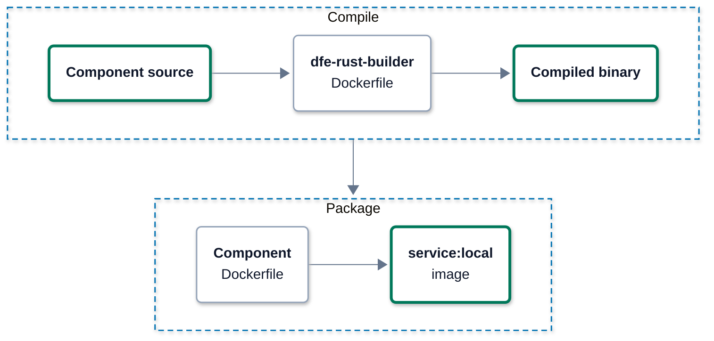

<!--
Project:   dfe-docker
File:      docs/developing.md
Purpose:   Using the Compose stack as a local test rig for DFE component work
Language:  Markdown

License:   BUSL-1.1
Copyright: (c) 2026 HYPERI PTY LIMITED
-->

# Developing against the stack

This applies to you if you are working on a DFE component and need a stack to
test it against.

You do not develop *this* repo to change component behaviour - it is packaging. What you get from it is a running pipeline that either pulls published images or compiles your local component source. The suites that test events traverse it are in [testing.md](testing.md) and [checks.md](checks.md).

Read [architecture.md](architecture.md) first if you have not: which services
exist, and how a profile decides which of them run.

## Prerequisites

| Need | For |
|---|---|
| Docker and Docker Compose v2 | everything |
| Python 3 | the helper scripts under `scripts/` |
| uv | `make sources`, `make rules`, `make hunts`, `make events`, `make orgs`, `make accounts`, `make test-e2e`, `make test-resilience` and `make test-flows` only. It installs the PyYAML and Playwright those scripts declare inline, hash-checked against the `<script>.lock` beside each |
| ruff | `make check-python` only |
| pytest | `make check-tests` only (`uvx` fetches the pin if you have it) |
| git, to clone the public hyperi-io repos (or `DFE_SRC_ROOT` checkouts) | `make dev` |

## First run

```bash
make up                    # init, pin the newest stable stack, start, self test, print the login
make up PROFILE=slim-grpc VERSION=X.Y.Z   # a profile and a stack of your choosing
```

`make up` runs `scripts/quickstart.py`, which makes `.env` when it is missing, writes `PROFILE=` to it as `DFE_PROFILE` and pins `VERSION=` (the newest published stable stack when none is given and the `.env` holds no pins). `DEFAULT_PROFILE` in the Makefile is the profile when none is set. These are its steps and each works on its own and `make help` lists every target:

```bash
make init                  # generate .env and env/<service>.env
make stack VERSION=X.Y.Z   # pin the image versions
make ci                    # pull and start, self test
```

`make init` copies `.env.example` to `.env` and every `env.example/<service>.env` to `env/<service>.env`, never over an existing file. It mints each secret into the file that holds it, topping up a file that predates a key and lists the keys an old `.env` is missing without editing it.


`make stack VERSION=X.Y.Z[-rc.N]` rewrites only the `*_VERSION` pins in `.env`, so your ports, hosts, credentials and profile survive. It renders from a local dfe-infra checkout only when `DFE_INFRA_DIR` names one (`scripts/dfe-stack render --target docker --stack VERSION`). Otherwise it resolves `ghcr.io/hyperi-io/dfe-stack-manifest:VERSION` to a digest, checks with `cosign verify` that dfe-infra's release workflow signed it and pulls it with `oras`, running either through Docker where it is not installed.

`make stack VERSION=latest` pins the newest published stack (`rc` ranks pre-releases) and records the word in `.env`, so a re-run moves forward. `DFE_STACK_REPIN_IMAGES=1` repins every DFE image at the release its GitHub repo marks Latest, a combination nobody certified. [deploying.md](deploying.md#staying-current-pinned-or-track-latest) has both. Skipping `make stack` aborts every compose command with a message naming the missing pin.

## Logging in the first time

The deploy mints the credentials, the engine never ships one. `make init` writes
two random passwords into `env/engine.env` and prints neither.

| Target | What it does |
|---|---|
| `make init` | mints `DFE_ENGINE_AUTH_LOCAL_ADMIN_PASSWORD` (the `admin` login) and `DFE_ENGINE_AUTH_BREAKGLASS_PASSWORD` (the `breakglass` recovery login) |
| `make up` | starts the pinned stack, runs the self test, then prints the access summary with the login |
| `make creds` | prints that summary again, any time |

The password prints to a terminal only. A pipe, a file, CI or `DFE_CREDS_SHOW=0` gets the `env/engine.env` key holding it instead. `make ci` prints no login, which is why `make up` exists. The engine's login page names `make creds` while first-run setup is incomplete. How the two accounts rotate and survive is in [operating.md](operating.md#only-the-console-and-its-search-authenticate).

The engine will not start on an empty or `changeme` `DFE_ENGINE_AUTH_LOCAL_ADMIN_PASSWORD` unless `DFE_ENGINE_ENV` names a dev environment and `make check-compose` asserts the compose file never hands it one.

`make dev` is the exception and says so: it writes the known default password into `env/engine.env` and `DFE_ENGINE_ENV=dev` into `.env`, because a dev loop should not need a lookup to log in. The engine accepts the default in that environment and makes the admin replace it at first login. A `.env` in a dev environment keeps the replacement `make post` recorded. It stops (exit 2) rather than run when `.env` declares a non-dev `DFE_ENGINE_ENV`: downgrading a deployment's environment and overwriting its admin password is not a build target's call. Start that stack with `make up`.

When it does rewrite, it copies each file it replaces to `<name>.bak-<utc>` beside it first, mode 0600, then prints the paths: a minted password is gone once overwritten. A run with nothing to change writes neither.

`AUTH=real` is the same local build against a deployment's authentication flow, for when the login is the thing under test. It mints a password and writes `DFE_ENGINE_ENV=production` and leaves either as it is where a deployment set it, so it never stops. `make creds` reads the password back.

```bash
make dev              # local images, DFE_ENGINE_ENV=dev, known default password until replaced
make dev AUTH=real    # local images, minted password, DFE_ENGINE_ENV=production
```

## Dev mode compiles your source, registry mode pulls GHCR

```bash
make dev    # build :local images from local component source, then start
make ci     # pull the pinned GHCR images, then start
```

`make dev` builds the `:local` images, then starts with the overlay the build writes, `.tmp/docker-compose.local.yml`, which repoints each component it built at `<service>:local` and empties the engine's `DFE_ENGINE_STACK_IMAGES`, so the console shows `DFE_STACK_VERSION`. `make ci` names no overlay. Both run `make env-files` first, which creates any `env/<service>.env` a release added and warns, never edits, when a template adds a key.

`scripts/build_dev_images.py` builds the `:local` images in two stages for every Rust component. The repo's Rust builder compiles the binary and the component's Dockerfile packages it.



*Figure 1. L4 Detail - Dev image build. Green boxes are files and images, grey boxes are build steps.* Up: [dfe-docker documentation](README.md).

This repo owns the build and the component owns the runtime. The builder image holds the toolchain, the pinned Rust version and hyperi-ci's static C library prefix (librdkafka, OpenSSL, zstd, zlib), so no runtime image installs those libraries and the runtime image you test is the one the component ships. `dfe-engine`, `dfe-ui` and `dfe-hyperdx` build straight from their own Dockerfile. ClickHouse, the broker and `kafka-ui` are skipped with a message.

A service that runs a component's image under another name follows it: `dlq-init` runs the archiver image, `dfe-hunt-runner` and `dfe-dashboards` the engine image. The map is `IMAGE_CONSUMERS` in `scripts/build_dev_images.py` and `make check-compose` asserts the overlay a full build writes covers all of it.

The `contract-<app>` one-shots are the deliberate
exception: they emit an artefact of the PINNED release and stay on the registry
pin while a local build runs beside them, because moving them onto `:local` would
make a core-only profile compile the Rust components to emit a few files.

Two of them can start without their component (`IMPLICIT_CONSUMERS`, same file):
`dlq-init`, which a `depends_on` starts under every Rust app, and
`dfe-dashboards`, which starts with `dfe-hyperdx` whether or not the engine runs.
`make dev` builds the archiver or the engine for them even on a profile that runs neither, so every DFE image its stack starts comes from source.

## Some from source, the rest pinned

```bash
make dev LOCAL="dfe-engine dfe-ui"   # build these two; everything else from GHCR
```

The build writes `.tmp/docker-compose.local.yml` repointing only the components it lists and the services sharing their image at `:local` and empties the engine's `DFE_ENGINE_STACK_IMAGES`, so the console shows `DFE_STACK_VERSION`. `SERVICES` still filters what starts and a name outside the resolved stack is a hard error.

Source comes via git, never an assumed directory layout:

- The default is the managed cache. The builder clones each component repo from `DFE_SRC_REMOTE` (default `https://github.com/hyperi-io`) into `DFE_SRC_CACHE` (default `~/.cache/dfe-docker/src`) and builds the commit `DFE_SRC_REF` resolves to (default `main`). Re-runs fetch and re-checkout, so the cache tracks the ref. The cache is tool-managed: a dirty checkout there fails the build rather than silently building someone's stray edits.
- For local work, set `DFE_SRC_ROOT`. Point it at the directory holding your `dfe-*` checkouts (in `.env` or the `make` command line) and the builder uses those working trees as they stand, uncommitted changes included. Nothing is inferred from where this repo lives.

`make stack`'s local-render path is explicit the same way: it uses a dfe-infra
checkout only when `DFE_INFRA_DIR` names one, and otherwise pulls the signed OCI
stack manifest.

`make dev LIVE_UI=1` runs the console as `next dev` over your checkout, so an edit reaches the browser without a rebuild. [live-console.md](live-console.md) covers it.

## Picking a profile

`service_profiles.yaml` decides which DFE services run and which config each mounts. `active_profile` is the default and `DFE_PROFILE` overrides it for one invocation. Which profile runs what is in [profiles.md](profiles.md).

```bash
DFE_PROFILE=single-kafka make dev     # override the profile
KAFKA_BACKEND=apache make dev         # Apache Kafka instead of Redpanda
DFE_CORE_ENABLED=false make dev       # skip engine, UI, proxy and dfe-hyperdx
DFE_CLICKHOUSE_ENABLED=false make dev # no warehouse container (external instance)
DFE_HYPERDX_ENABLED=false make dev    # skip the dfe-hyperdx observability stack
make dev SERVICES="dfe-loader"        # start a subset of the resolved profile
```

`DFE_CLICKHOUSE_ENABLED`, `DFE_CORE_ENABLED`, `KAFBAT_ENABLED`, `DFE_HYPERDX_ENABLED` and `DFE_OTEL_ENABLED` mirror the `clickhouse`, `core`, `kafbat`, `hyperdx` and `otel` keys a profile may declare and they win over it - `.env` is what a deploy writes, the profile is the committed setting. Leave them unset and the profile decides.

Two of those need a warning.

`DFE_CORE_ENABLED=false` drops `dfe-engine` and **dfe-engine is the schema authority** - nothing else provisions the ClickHouse tables or registers the schemas the loader pre-warms. Without it the loader holds messages pending-schema and dead-letters them, so the data path looks broken when it is really unprovisioned. Use it when you are working on the UI or proxy against existing tables, not on a fresh stack.

`make dev SERVICES="..."` does not start a subset on top of a running stack, because `dev` depends on `down`, which tears down every profile first.

A name in `SERVICES` that is not part of the resolved stack is a hard error, not a silent no-op. Adding a config to a profile that does not exist on disk is caught: `resolve_profile.py` validates every `config_path` before writing `.tmp/profile.mk`.

## What bites

`make down` tears down every profile, not just the active one: `docker compose -f docker-compose.yml --profile "*" down --remove-orphans`, keeping volumes. `make dev` and `make ci` run it first, so `make dev SERVICES="dfe-loader"` stops everything else.

A key set in `.env` beats the same variable in your shell through make, so `DFE_PROFILE=single-kafka make dev` uses the `.env` value. [known-issues.md](known-issues.md#env-shadows-command-line-environment-variables-through-make) has the ways round it.

Compose `environment:` beats `env/<service>.env`. A key listed in a service's `environment:` block in `docker-compose.yml` wins over the same key in the per-service env file. `LOG_LEVEL` is forwarded by compose, so setting it in `env/receiver.env` does nothing, but a key compose does not forward reaches the container fine.

A one-shot's `sh -c` command is a list of one. Compose splits a scalar `command:` into argv, so `sh -c` would run only its first word.

On a shared dev host the broker's one host port is `19092` and [common-failures.md](common-failures.md#port-is-already-allocated) shows how to move it. The same reasoning applies to ClickHouse (`CLICKHOUSE_HTTP_PORT`, `CLICKHOUSE_NATIVE_PORT`) and every `*_PROMETHEUS_PORT`: services in the stack dial ClickHouse on 8123/9000 whatever its host publish is. The `CLICKHOUSE_EXTERNAL_*_PORT` pair is not a host port. It is only for an external `CLICKHOUSE_HOST`.

`make dev` and `make ci` try to bind every host port the resolved stack publishes before starting and refuse with the variable to set for each one in use (scripts/port_check.py).

Beside another stack on the same daemon, ports are not enough, because every
`container_name` is daemon-wide. Set `COMPOSE_PROJECT_NAME`, the ports above,
and `DFE_E2E_COMPOSE_FILES` naming an extra compose file (`:`-separated) the
suite chains onto every `up`, one that re-prefixes each `container_name`.

A build failure in dev mode is usually a component-repo problem. The builder

compiles from staged source with no `target/` -- it uses a cache mount rather than
your local build artefacts, so a first build after a toolchain change is slow, and
a compile error is yours, not the harness's.

## Related

- [testing.md](testing.md) - the e2e suite and its detection and console tests
- [checks.md](checks.md) - outage tests, the post-deploy source test, static checks
- [seeding.md](seeding.md) - the starter sources, rules, hunts, orgs and accounts
- [architecture.md](architecture.md) -- components, transports, how data moves
- [observability.md](observability.md) -- health surface, self-telemetry, the self test
- [configuration.md](configuration.md) -- every variable, port and image
- [troubleshooting.md](troubleshooting.md) -- diagnosing a stack that misbehaves
