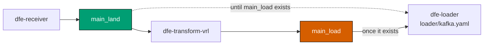

<!--
Project:   dfe-docker
File:      docs/known-issues.md
Purpose:   Open problems on the Compose stack whose symptoms mislead
Language:  Markdown

License:   BUSL-1.1
Copyright: (c) 2026 HYPERI PTY LIMITED
-->

# Known issues

These are real and open. Each one has a symptom that misleads.

Several of these look like something else entirely, so read them before you go deep
into [troubleshooting](troubleshooting.md).

## Stray containers from a previous profile (fixed, but worth recognising)

`make down` now runs `docker compose -f docker-compose.yml --profile "*" down
--remove-orphans`, so it tears down every profile and keeps volumes. Switching
profiles no longer strands anything.

On an older checkout it is still profile-scoped: switch from a profile with a receiver to one without and the old receiver keeps running, keeps answering on `:8080` and keeps its ports. The misleading part is that the stray is wired to a pipeline that is no longer running, so anything probing ports rather than asking the profile finds it and reports a data-path failure that is really a stale container. That is why `scripts/post.py` resolves its ingest edge from `.tmp/profile.mk` instead of probing.

If you suspect strays, `docker ps` and compare uptimes: a container minutes older than the rest is the giveaway.

## `.env` shadows command-line environment variables through make

The Makefile does `-include .env`. GNU make gives makefile assignments precedence over environment variables and re-exports them to recipes. So for any key with a live (uncommented) assignment in `.env`, `VAR=x make ...` silently no-ops: the child process sees the `.env` value.

This was reproduced with a throwaway Makefile carrying the same `-include .env`, not against a target in this repo, which has no `make show`.

This bites hardest after `make stack` writes live `*_VERSION` pins into `.env` and after `make init` writes the generated secrets. Three ways around it:

```bash
make dev KAFKA_BACKEND=apache     # a make command-line variable wins and is exported
KAFKA_BACKEND=apache make -e dev  # -e flips the precedence
```

...or edit `.env`, which is the durable answer.

## A `_load` topic changes what the loader reads



`config/loader/kafka.yaml` subscribes by `topic_regex: .*_(land|load)`. scalo drops `<base>_land` from the subscription whenever `<base>_load` exists. `dfe-engine` creates the bootstrap topic set `dfe-schemas` declares, which is `main_land` and the five DLQ topics, so `main_load` exists only once a transform first produces to it.

Once a transform runs, the loader therefore reads `main_land` until that first write, then switches to `main_load`. The first records land twice: once raw, once transformed. Create the transform's `_load` topic before sending anything to avoid it. The e2e suite does, from each test's `expected_topics`.

**Do not close this gap by adding `main_load` to the bootstrap topic set.** The loader auto-discovers topics and scalo suppresses `<base>_land` whenever `<base>_load` exists, on the reasoning that a `_load` topic means a transform has already produced the loadable form. Creating `main_load` on every Kafka profile therefore drops `main_land` from the subscription of every loader not running a transform, which is most of them. The symptom is maximally misleading: ingest returns 200, the receiver produces to `main_land`, the topic shows a rising high watermark and no rows reach ClickHouse.

Reverting the change does not restore a broker that already has the topic.
`kafka-redpanda-data` and `kafka-apache-data` outlive the containers, so the topic
persists and keeps suppressing `main_land` on every later run. Delete it:

```bash
docker compose exec kafka-redpanda rpk topic delete main_load -X brokers=kafka:9092
```

The e2e harness now does this for itself: `clean_topics` deletes the `_load`
sibling of every expected `_land` topic, so a run depends on the test definition
rather than on the broker's history.

When the injected events do not land, `make post` asks the loader which topics it
is fetching, so an empty subscription is reported as one. It cannot ask first: the
loader publishes a topic's lag only once it has committed an offset there, which a
stack started from empty volumes has not.
