<!--
Project:   dfe-docker
File:      docs/known-issues.md
Purpose:   Open problems on the Compose stack whose symptoms mislead
Language:  Markdown

License:   BUSL-1.1
Copyright: (c) 2026 HYPERI PTY LIMITED
-->

# Known issues

These are open and each has a symptom that misleads.

Several of these look like something else entirely, so read them before you go deep
into [troubleshooting](troubleshooting.md).

## `.env` shadows command-line environment variables through make

The Makefile does `-include .env`. GNU make gives makefile assignments precedence over environment variables and re-exports them to recipes. So for any key with a live (uncommented) assignment in `.env`, `VAR=x make ...` silently no-ops: the child process sees the `.env` value.

This bites hardest after `make stack` writes live `*_VERSION` pins into `.env` and after `make init` writes the generated secrets. Three ways around it:

```bash
make dev KAFKA_BACKEND=apache     # a make command-line variable wins and is exported
KAFKA_BACKEND=apache make -e dev  # -e flips the precedence
```

...or edit `.env`, which is the durable answer.

`make up` and `make demo` go further: they read `PROFILE=` and `VERSION=` from the make line alone, so `PROFILE=slim-grpc make up` starts whatever profile `.env` names and a `PROFILE` exported in your shell never moves the stack. Write `make up PROFILE=slim-grpc` instead.

## A `_load` topic changes what the loader reads

The receiver produces to `main_land` and a transform to `main_load`. The loader reads `main_load` when it exists and `main_land` when it does not.

```mermaid
---
config:
  theme: base
  look: neo
  fontFamily: Inter, -apple-system, Segoe UI, Roboto, Helvetica, Arial, sans-serif
  flowchart:
    curve: linear
    nodeSpacing: 40
    rankSpacing: 64
    padding: 18
    wrappingWidth: 280
    htmlLabels: true
  elk:
    preset: modelOrder
  themeVariables:
    fontSize: 15px
    lineColor: "#64748B"
    primaryTextColor: "#0F172A"
    clusterBorder: "#0072B2"
    edgeLabelBackground: "#FFFFFF"
  themeCSS: >-
    p{margin:0}
    .node[data-look] rect,.node[data-look] path,.node[data-look] polygon,.node[data-look] .outer-path{filter:drop-shadow(0 1px 2px rgba(15,23,42,.10)) drop-shadow(0 6px 14px rgba(15,23,42,.10))}
    .node rect{rx:10px;ry:10px}
    .cluster rect{rx:16px;ry:16px}
    .node .label div{min-width:150px}
    .node.decision .label div{min-width:0}
    .cluster[data-look] rect{filter:none}
    .nodeLabel{line-height:1.35}
    .nodeLabel b{font-weight:600;font-size:15px;letter-spacing:-0.01em}
    .nodeLabel span{font-size:12.5px;font-weight:400;color:#334155}
    .cluster-label span.nodeLabel{display:inline-block;background:#FFFFFF;color:#0B2A3F;border:1.5px solid #0072B2;border-radius:999px;padding:2px 12px;font-size:11.5px;font-weight:700;letter-spacing:.09em;text-transform:uppercase}
    .flowchart-link{stroke-width:1.75px}
    .labelBkg{background:transparent!important}
    span.edgeLabel{display:inline-block;background:#FFFFFF!important;color:#1E293B;border:1px solid #94A3B8;border-radius:999px;padding:2px 10px;font-size:12px;font-weight:500}
    span.edgeLabel p{background:transparent!important}
    .label-icon{width:20px;height:20px;vertical-align:-4px;margin-right:6px}
    .ingest .label-icon{color:#0E8A7D}
    .xform .label-icon{color:#7B4FB0}
    .load .label-icon{color:#0072B2}
    .bus .label-icon{color:#A8517F}
    .store .label-icon{color:#00785A}
    .ui .label-icon{color:#D9480F}
    .ext .label-icon{color:#64748B}
---
flowchart LR
    accTitle: L4 Detail -- Loader topic choice
    accDescr: The loader resolves its topics. If main_load exists it reads main_load and drops main_land from its subscription. If not, it reads main_land.

    resolve(["<b>Loader resolves</b><br/><span>its topics</span>"])
    exists{"<b>main_load</b><br/><span>exists?</span>"}
    land(["<b>Reads main_land</b>"])
    load(["<b>Reads main_load</b><br/><span>drops main_land</span>"])

    resolve --> exists
    exists -->|no| land
    exists -->|yes| load

    class resolve,land part
    class exists decision
    class load error
  classDef ext fill:#F4F6F8,stroke:#94A3B8,stroke-width:1.5px,stroke-dasharray:5 4,color:#0F172A
  classDef ingest fill:#FFFFFF,stroke:#0E8A7D,stroke-width:3px,color:#0F172A
  classDef xform fill:#FFFFFF,stroke:#7B4FB0,stroke-width:3px,color:#0F172A
  classDef load fill:#FFFFFF,stroke:#0072B2,stroke-width:3px,color:#0F172A
  classDef bus fill:#FFFFFF,stroke:#A8517F,stroke-width:3px,color:#0F172A
  classDef store fill:#FFFFFF,stroke:#00785A,stroke-width:3px,color:#0F172A
  classDef ui fill:#FFFFFF,stroke:#D9480F,stroke-width:3px,color:#0F172A
  classDef decision fill:#FFFFFF,stroke:#9A6700,stroke-width:3px,color:#0F172A
  classDef error fill:#FFFFFF,stroke:#C2410C,stroke-width:3px,color:#0F172A
  classDef control fill:#FFFFFF,stroke:#334155,stroke-width:3px,color:#0F172A
  classDef part fill:#FFFFFF,stroke:#94A3B8,stroke-width:1.5px,color:#0F172A
```



*Figure 1. L4 Detail - Loader topic choice. The orange end is the trap when no transform reads `main_land`.* Up: [L2 Services - DFE Compose stack](architecture.md#events-arrive-two-ways-and-leave-one).

`config/loader/kafka.yaml` names no topics, so the loader auto-discovers every topic ending in `_land` or `_load` (its `routing.topic_suffixes` default). scalo drops `<base>_land` from the subscription whenever `<base>_load` exists. `dfe-engine` creates the bootstrap topic set `dfe-schemas` declares, which is `main_land` and the five DLQ topics, so `main_load` exists only once a transform first produces to it.

Once a transform runs, the loader therefore reads `main_land` until that first write, then switches to `main_load`. The first records land twice: once raw, once transformed. Create the transform's `_load` topic before sending anything to avoid it. The e2e suite does, from each test's `expected_topics`.

**Do not close this gap by adding `main_load` to the bootstrap topic set.** The loader auto-discovers topics and scalo suppresses `<base>_land` whenever `<base>_load` exists, on the reasoning that a `_load` topic means a transform has produced the loadable form. Creating `main_load` on every Kafka profile therefore drops `main_land` from the subscription of every loader not running a transform, which is most of them. The symptom is maximally misleading: ingest returns 200, the receiver produces to `main_land`, the topic shows a rising high watermark and no rows reach ClickHouse.

Reverting the change does not restore a broker that has the topic. `kafka-apache-data` and `kafka-redpanda-data` outlive the containers, so the topic persists and keeps suppressing `main_land` on every later run. `rpk topic list` in the broker container shows whether it is there. Delete it:

```bash
docker compose exec kafka-redpanda rpk topic delete main_load -X brokers=kafka:9092
```

The e2e harness does this itself: `clean_topics` deletes the `_load` sibling of every expected `_land` topic, so a run depends on the test definition rather than on the broker's history.

When the injected events do not land, `make post` asks the loader which topics it
is fetching, so an empty subscription is reported as one. It cannot ask first: the
loader publishes a topic's lag only once it has committed an offset there, which a
stack started from empty volumes has not.
