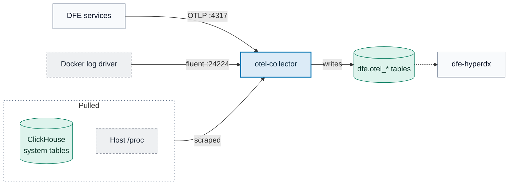

<!--
Project:   dfe-docker
File:      docs/observability.md
Purpose:   How the stack reports on itself, and what each surface proves
Language:  Markdown

License:   BUSL-1.1
Copyright: (c) 2026 HYPERI PTY LIMITED
-->

# How the stack reports on itself

Three surfaces, three different questions.

| Surface | Answers | Where |
|---|---|---|
| Health endpoints | is this process alive, and is it ready to work | `/livez`, `/readyz` |
| Self-telemetry | what has the stack been doing | the `dfe.otel_*` tables |
| The self test | did an event actually get through | `make post`, in [self-test.md](self-test.md) |

Ingested data is a different question -- [troubleshooting.md](troubleshooting.md). What `make post` claims is in [self-test.md](self-test.md), and the components and transports in [architecture.md](architecture.md).

## The health surface is three paths, with no aliases

Every DFE service serves `/livez`, `/readyz` and `/metrics` on its observability
port and nothing else. `/healthz` and the `/health/*` paths are retired and
**404 on every image pinned here**. `make check-compose` rejects any healthcheck
aimed at one.

| Service | Host port | Notes |
|---|---|---|
| dfe-receiver / loader / archiver | 9090, 9091, 9093 | all three paths |
| dfe-fetcher and transform instances | none | all three paths on container port 9090, over the Docker network |
| dfe-engine | 8003 | `/metrics` is on its container's own 9090, unpublished |
| dfe-ui | none | all three on `:3000`, alongside the app |
| dfe-proxy | 3000 | `/livez`, answered by Envoy itself |
| otel-collector | 13133 | the `health_check` extension |
| dfe-hyperdx | 8000 | `/health` -- upstream HyperDX's own convention |

The metrics ports bind `DFE_BIND_HOST` and the engine, proxy and dfe-hyperdx
ports `DFE_UI_BIND_HOST`, both `127.0.0.1` by default, so curl them from the box,
not your laptop.

On dfe-ui, an unknown path returns the 200 app shell rather than a 404 -- Next.js
routes anything it does not recognise to the page. Only the three paths above are
served there.

## Compose gates on readiness, so the gated services report it

Compose has no readiness condition. `depends_on: service_healthy` is the only
startup gate, so anything others wait on must report READINESS.

| Service | Path | Why |
|---|---|---|
| dfe-loader | `/readyz` | receiver and fetcher wait on it |
| dfe-engine | `/readyz` | loader and proxy wait on it, and it provisions their schema |
| dfe-proxy, dfe-hyperdx-proxy | Envoy admin `/ready` on 9901 | no curl in the image, so bash `/dev/tcp` sends the request |
| dfe-hyperdx | `/health` on 8000 | its own convention, through `node`, as the image has no curl |
| everything else | `/livez` | nothing gates on them |
| otel-collector | none | distroless, so nothing inside can probe `:13133` |

A loader gated on liveness reports healthy while unable to reach ClickHouse, and
the receiver starts against it.

Kubernetes has separate probes and ignores `HEALTHCHECK`, so it never chooses.

## Self-telemetry is pushed, bar four pulls

The stack's own telemetry leaves by a different door from the data it ingests, so
a broken ingest pipeline cannot take the reporting on it down. Services push to the collector, the collector pulls ClickHouse and the host, and dfe-hyperdx queries what it writes.



*Figure 1. L4 Detail -- Self-telemetry. The dotted arrow is a read, and the collector's own `:8888` metrics and dfe-hyperdx's `:8000` are scraped.* Up: [dfe-docker documentation](README.md).

Services PUSH. dfe-hyperdx reads ClickHouse rather than receiving anything -- the
fork ships no OTLP receiver, so the collector's exporter writes the tables it
queries. This is the same chain Kubernetes runs.

Four of the collector's inputs are PULLS, because their sources cannot push. `host_metrics` reads the docker host's CPUs for the usage readings below.
`sql_query` reads ClickHouse's own `system.metrics`, `system.events` and
`system.parts` on a 30s interval -- the `:9363` Prometheus endpoint is not exposed
by the stack's image, and these system tables are readable on any provider,
managed ClickHouse included. The `prometheus` receiver scrapes the collector's own
`service.telemetry` endpoint on 127.0.0.1:8888, which puts queue depth and
refused/failed counts (`otelcol_*`) into the same pipeline, and dfe-hyperdx's API
at `dfe-hyperdx:8000`. `sql_query/usage` is the fourth, below.

`sql_query` and `prometheus` are what the pre-canned DFE ClickHouse Health and DFE Pipeline Health dashboards read. Without them those dashboards render empty here while working on Kubernetes.

`/metrics` is a SEPARATE pathway, for anything that scrapes. Nothing in this
repo scrapes a DFE app's `/metrics`, and enabling push does not disable it, so a
Prometheus estate and an OTLP one are both served.

dfe-engine's Overview counts cores from the usage rollup dfe-schemas declares. That rollup reads the Kubernetes metric names, so the collector reports Compose in it:

| Reading | Where it comes from here | Table |
|---|---|---|
| `k8s.container.cpu_request` | `sql_query/usage`: the CPU limit of each service the stack runs | `otel_metrics_gauge` |
| `k8s.pod.phase`, 2 (Running) | the same query, at the same instant, which the rollup needs beside each limit | `otel_metrics_gauge` |
| `system.cpu.logical.count` | `host_metrics`, through the host's `/proc` mounted read-only at `/hostfs/proc` | `otel_metrics_sum` |

All three have `k8s.node.name`, the docker host's name, which joins a service's cores to its host's.

- Compose sets CPU limits where Kubernetes counts requests, so a service counts its ceiling. When limits add up to more than the host has, cores deployed reads higher than worker-node cores.
- A one-shot (`restart: "no"`) exits once its job is done and does not count. A service with no CPU limit (`DFE_SERVICE_CPUS=0`, say) counts every core on the host.
- `make dev`, `ci`, `up`, `infra` and `apply` read the limits from the compose model of what `up` starts and hand them to the collector as `DFE_USAGE_CPU_LIMITS` and `DFE_USAGE_NODE_NAME`. A collector started by a plain `docker compose up` has neither, so cores deployed reads as not measured. `make apply` recreates the collector when an added or deleted source moved them.

## What reports, and turning it off

Every profile declares `otel: true`. `DFE_OTEL_ENABLED=false` turns it off.
Container stdout reaches `dfe.otel_logs` through Docker's fluentd log driver
unless `DFE_CONTAINER_LOGS_ENABLED=false`, below.

| Variable | Default | Effect |
|---|---|---|
| `DFE_OTEL_ENABLED` | unset, the profile decides | starts the bundled collector |
| `DFE_OTEL_EXPORTER_ENDPOINT` | empty | where services push -- **empty exports nothing** |
| `DFE_OTEL_DATABASE` | `dfe` | database the collector writes |
| `DFE_OTEL_HEALTH_PORT` | `13133` | the `health_check` extension |
| `DFE_ENGINE_API_METRICS_BACKEND` in `env/engine.env` | `opentelemetry` | makes dfe-engine push. `prometheus` serves `/metrics` only |

The endpoint decides where services push. Enabling the profile points services at the bundled
collector. Name your own endpoint and they push there instead, which is how you
feed an external OTLP backend with no bundled collector at all.

The collector's OTLP ports are NOT published. Self-monitoring stays on the
Compose network. Note `4317`/`4318` on the host are dfe-receiver's OTLP INGEST
edge -- data coming in from your estate, pointing the other way.

What reports:

| Component | Pushes? | Why |
|---|---|---|
| the seven Rust services | metrics and traces | scalo's `metrics` feature pulls `otel-metrics` and `otel-tracing`, so OTLP export is on by default (scalo-rs#30) |
| dfe-engine | metrics and traces, on the `opentelemetry` backend `env/engine.env` ships | scalo-py's exporter, and its CLI defaults the backend to `opentelemetry` (scalo-py#11) |
| dfe-hunt-runner | metrics, as `dfe_hunt_*` | it has no listener to scrape and its default `opentelemetry` backend pushes on `OTEL_EXPORTER_OTLP_ENDPOINT` alone |
| dfe-ui | metrics, over OTLP/HTTP | `@opentelemetry/sdk-metrics` from its `instrumentation.ts`, on `DFE_OTEL_EXPORTER_HTTP_ENDPOINT`. It serves `/metrics` on `:3000`. The self test needs its rows, like every pusher here (`OTEL_PUSHER_PREFIXES` in `scripts/post.py`) |
| every DFE service | LOGS, via Docker's log driver | nothing in the stack exports logs over OTLP, so stdout is shipped instead -- see below |

`OTEL_EXPORTER_OTLP_ENDPOINT` is set on every service regardless, so a rebuilt
component starts reporting with no config change here.

Each Rust service pushes the scalo chassis set -- the `worker_pool_*` family,
`process_*` and `container_*` -- plus whatever it defines itself, and the loader adds
`rdkafka_*`. What decides whether a service reports is the scalo version its image
links, not this repo's configuration.

The `opentelemetry` backend is DUAL -- it pushes and keeps serving `/metrics`
(`readers=[otlp(grpc)->..., prometheus(/metrics)]`), so the switch costs a
scraping estate nothing.

## Container logs go through the log driver, not a file reader

Nothing in the stack exports logs over OTLP, so the lines a service writes to stdout reach ClickHouse a different way: Docker's own `fluentd` log driver sends them to the collector's `fluent_forward` receiver, which turns the driver's tag into `ServiceName` and writes `dfe.otel_logs`. Search them in dfe-hyperdx on the `otel_logs` source.

Kubernetes reads the same lines off the node with a DaemonSet filelog receiver.
That does not port: the files live under the daemon's data-root, which is not
`/var/lib/docker` on every host and is not on the host at all under Docker
Desktop, and listing that directory needs root. The log driver needs no host path
and no privilege.

**`docker compose logs` still reads these services.** Docker's dual logging keeps a local copy of each line, so the driver adds the collector without taking the CLI away. Only DFE's own services and dfe-hyperdx move onto the driver: ClickHouse, the broker and the proxies keep `json-file`. Put every service back with:

```bash
DFE_CONTAINER_LOGS_ENABLED=false
```

| Variable | Default | Effect |
|---|---|---|
| `DFE_CONTAINER_LOGS_ENABLED` | `true` | ships DFE container stdout when a collector runs |
| `DFE_CONTAINER_LOG_ADDRESS` | `tcp://<DFE_BIND_HOST>:<DFE_OTEL_FLUENT_PORT>` | where the DAEMON sends it |
| `DFE_OTEL_FLUENT_PORT` | `24224` | the collector's receiver, on `DFE_BIND_HOST` |

The driver runs with `fluentd-async`, so a container starts whether or not the
collector is up. Without it Docker will not create a container it cannot reach
a logging endpoint for, which would put the collector on the startup path of the
whole stack. Lines written while the collector is down queue in the daemon and
are sent when it answers.

It runs with `fluentd-request-ack`, and the queue depends on it. The
collector's host port is Docker's port proxy, which accepts connections from the
moment the container starts, before the collector inside is listening, and drops
what it is sent. Without an ack the driver counts those lines as delivered, and a
service starting beside the collector loses its startup lines.

Of the host's own metrics only its CPUs are collected, for the usage readings.
