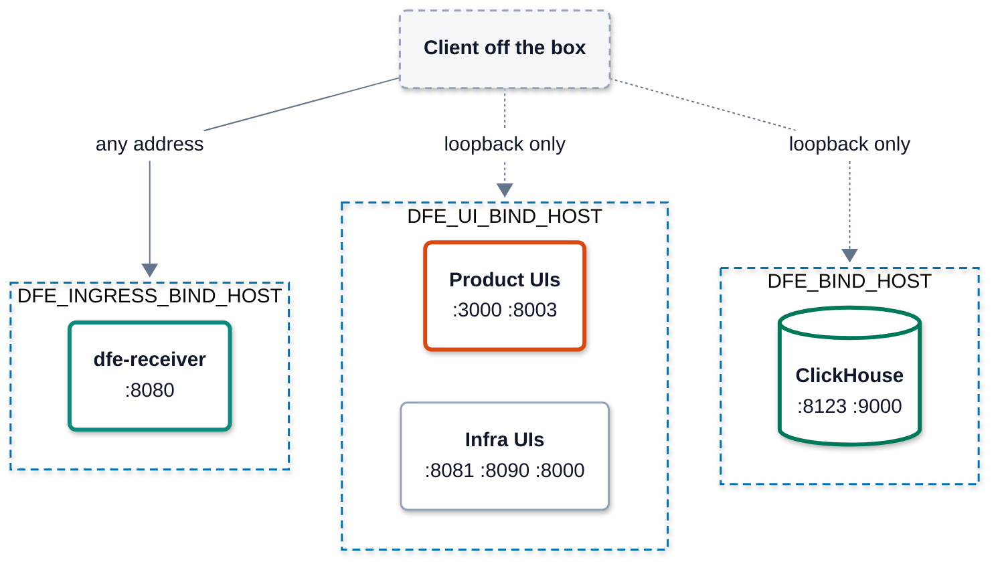
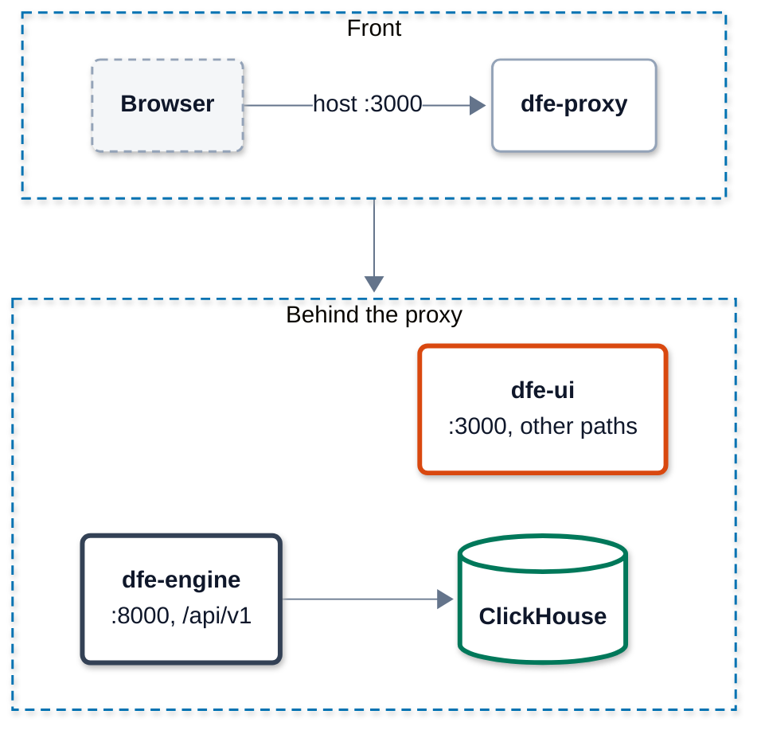
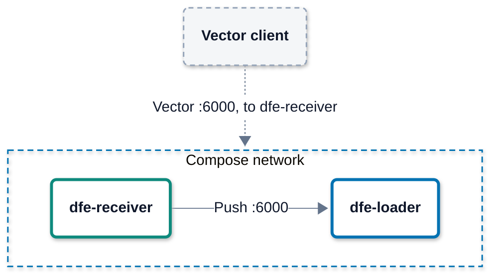

<!--
Project:   dfe-docker
File:      docs/operating.md
Purpose:   Operating the Compose stack where other people depend on it
Language:  Markdown

License:   BUSL-1.1
Copyright: (c) 2026 HYPERI PTY LIMITED
-->

# Operating the DFE Compose stack

This applies to you if other people depend on this stack: a single box, an edge site or a partner deployment. Small is still production, and the defaults are tuned for a laptop. Kubernetes remains the primary path, so if both would work, choose Kubernetes. This page covers access, port exposure and resource limits.
Secrets and what a backup has to cover are in [secrets-and-storage.md](secrets-and-storage.md),
and the broker in [broker.md](broker.md).

## Only the console and its Search authenticate

The engine's API needs a login. `make init` mints two passwords into `env/engine.env` and `make creds` hands them over: `admin` from `DFE_ENGINE_AUTH_LOCAL_ADMIN_PASSWORD`, and the `breakglass` recovery admin. The engine commits its hash to its deploy repo on first boot, so it outlives the engine, the UI and `env/engine.env`.

The engine issues `admin` with a forced change at first login, which `make post` makes and records back in `env/engine.env`. Rotate it by changing the value there and running `make up`. The value the engine last issued, or the account's current password, re-issues nothing, so a restart never undoes a change. The engine will not start when that password is empty or the shipped default and `DFE_ENGINE_ENV` is not a dev environment, and compose sets an unset `DFE_ENGINE_ENV` to `production`.

`make init` and `make up` write `access-summary.md` (0600, gitignored) with both passwords in plaintext. Once your own admin exists, retire the bootstrap admin from the console wizard's last step or `POST /api/v1/auth/setup/retire-admin`, then delete `DFE_ENGINE_AUTH_LOCAL_ADMIN_PASSWORD` from `env/engine.env`. The account stays disabled and is never reseeded. Keep the break-glass password offline and delete both plaintexts, that file included: the engine keeps only the hash.

dfe-hyperdx, the console's Search, authenticates by verifying the engine's token and holds no logins of its own. ClickHouse takes its generated password. Nothing else authenticates. The ingest edges, every metrics port and Kafka answer whoever can route to them, and so does Kafbat unless the `auth` profile is armed, where the gate is at the proxy, not inside the UI.

By default, off-box clients reach the receiver's ingest ports, and every other port answers on the box alone.



*Figure 1. L4 Detail -- Who reaches which port. Dotted arrows answer only on the box until `DFE_BIND_SCOPE=all` or `DFE_BIND_HOST=0.0.0.0` widens them.* Up: [dfe-docker documentation](README.md).

Behind those ports, dfe-proxy sends `/api/v1/*` to the engine ([console origin](#console-origin-and-the-port-6000-listeners)) and dfe-hyperdx queries ClickHouse for the browser.

## Two consequences survive the loopback defaults

**The engine API is reachable from wherever the console is.** `dfe-proxy` reverse-proxies `/api/v1/*` straight through to the dfe-engine API on the Docker network (`config/proxy/envoy.yaml`), so unpublishing the engine's own `:8003` does not take that API off `:3000`. The proxy adds no authentication, and the engine's own login protects it there as on `:8003`.

**dfe-hyperdx asks the engine who you are.** It runs in `oidc-proxy` mode, as on Kubernetes: it verifies the engine's ES384 token against the engine's JWKS, and a caller carrying none is unauthenticated. The console mirrors its session into a `dfe_token` cookie and cookies ignore ports, so one console login covers `:8090`, `:8091` and `:8000`. Its ClickHouse credential stays server-side, because queries go through dfe-hyperdx's own proxy.

dfe-docker never assumes an OIDC issuer exists, and no profile may require one. The `auth` profile ([auth-profile.md](auth-profile.md)) scopes OIDC to the infra UIs while the issuer runs. Ingest edges, machine API paths, `/.well-known`, `/livez`, every metrics port, ClickHouse and Kafka stay outside it. The Kubernetes tier does the same, applying OIDC per interactive route rather than at the Gateway, so a machine path is never redirected to a login.

Everything else answers whoever can route to it, so put the stack behind a VPN, an SSH tunnel, a firewall or an authenticating reverse proxy in front of `:3000`. The bindings below reduce the accidental surface. They are not access control.

## Port exposure is split by audience

Three variables, chosen by who the port is for.

| Variable | Default | Audience |
|---|---|---|
| `DFE_INGRESS_BIND_HOST` | `0.0.0.0` | What users push to: receiver ingest |
| `DFE_UI_BIND_HOST` | `127.0.0.1` | Every web UI. Derived from `DFE_BIND_SCOPE`, not set by hand |
| `DFE_BIND_HOST` | `127.0.0.1` | What operators reach: datastores, broker, metrics, internal gRPC |

Per-port, as published in `docker-compose.yml`:

| Host port | Service | Binds | Purpose |
|---|---|---|---|
| 3000 | dfe-proxy | ui | UI, plus `/api/v1/*` to the engine |
| 8091 | dfe-proxy | ui | dfe-hyperdx, as the console frames it |
| 8080 | dfe-receiver | ingress | HTTP ingest |
| 8090 | dfe-hyperdx-proxy | ui | dfe-hyperdx app UI |
| 8000 | dfe-hyperdx-proxy | ui | dfe-hyperdx API |
| 8003 | dfe-engine | ui | Config and schema API (container `:8000`) |
| 8081 | kafka-ui | ui | Kafbat UI (container `:8080`) |
| 8123 / 9000 | clickhouse | operator | HTTP and native protocol |
| 19092 | kafka (either backend) | operator | Plaintext host listener |
| 9090 | dfe-receiver | operator | Metrics and health |
| 9091 | dfe-loader | operator | Metrics and health |
| 9093 | dfe-archiver | operator | Metrics and health |
| 13133 | otel-collector | operator | `health_check` extension |
| 24224 | otel-collector | operator | `fluent_forward`, where the Docker daemon sends container stdout |

dfe-fetcher runs one container for every source and the three transforms run one instance per source. Neither publishes a host port, so their ingest, Vector API and metrics ports are reached over the Docker network. So is dfe-loader's `scalo.transport.v1.Transport/Push` listener on 6000. The receiver's Vector protocol on 6000 publishes only once `DFE_RECEIVER_GRPC_PORT` is set.

`dfe-ui`, `dfe-hyperdx` and `hyperdx-documentdb` publish no host
ports at all -- they are reached over the Docker network, dfe-hyperdx through the
proxy that holds both its origins. The collector's OTLP ports stay on the Compose network. The receiver's OTLP (`4317`, `4318`), Beats (`5044`), HEC (`8088`), syslog (`514` UDP and TCP, `6514`) and flow (`2055`, `4739`, `6343` UDP) listeners publish once their port key is set in `.env`. Those `4317`/`4318` are the receiver's *ingest* edge, not the collector's.

Setting `DFE_BIND_HOST=0.0.0.0` opens every operator port at once, including a
ClickHouse that runs with `CLICKHOUSE_DEFAULT_ACCESS_MANAGEMENT=1` behind one
password. Do it knowingly.

## Console origin and the port 6000 listeners

The console's client calls the engine with a relative `/api/v1/...` base URL, so `dfe-proxy` gives both one origin. It sends `/api/v1` to dfe-engine and every other path to dfe-ui.



*Figure 2. L4 Detail -- One console origin. The ports in the boxes are container ports.* Up: [L2 Services -- DFE Compose stack](architecture.md).

Two gRPC listeners share port 6000, and they aren't the same thing. A `*-grpc` profile runs both.



*Figure 3. L4 Detail -- Two listeners on port 6000. The dotted arrow is off until `config.grpc.enabled` is set.* Up: [L2 Services -- DFE Compose stack](architecture.md).

| Container port | Host port | Owner | Protocol | Audience | Binds |
|---|---|---|---|---|---|
| 6000 | none, until `DFE_RECEIVER_GRPC_PORT` is set | dfe-receiver | Vector protocol, an ingest source that listens only once `config.grpc.enabled` is set through the engine | external clients | `DFE_INGRESS_BIND_HOST` (`0.0.0.0`) |
| 6000 | none | dfe-loader | `scalo.transport.v1.Transport/Push`, internal transport | dfe-receiver, on a `*-grpc` profile | the compose network |

Every Push listener in the suite answers on 6000 and dfe-engine compiles each sender's endpoint against that port. The receiver's listener is meant to be reachable from outside the stack. The loader's is not, so it publishes no host port.

## Web UIs: one scope dial, one kill switch

Every web UI publishes by default. `DFE_BIND_SCOPE` says where:

| Mode | Publishes on | For |
|---|---|---|
| `localhost` (default) | `127.0.0.1` | A developer workstation -- the host sees every UI, the LAN does not |
| `all` | `0.0.0.0` | A small or VM deploy |

It moves the UI ports and nothing else. Ingest and the backing services keep the
two surfaces above, so widening the UIs never opens ClickHouse.

`all` needs `DFE_EXTERNAL_ORIGIN` set to the address browsers use. The
console embeds dfe-hyperdx behind a `frame-ancestors` policy built from that origin,
and next-auth builds its redirects from it, so at the default both name the
browser's own machine: the console loads with its observability views blocked and
sends logins back to loopback. Nothing can infer the address, so `make dev`,
`make ci`, `make up`, `make apply`, `make infra`, `make post`, `make test-source` and
`make test-flows` stop and name the key instead of starting a console that is
broken in that one place. The lifecycle and check goals are exempt -- `make down`
has to work whatever the configuration says.

Each UI has a class, and the class decides what can take it dark:

| UI | Service | Class | Flag |
|---|---|---|---|
| DFE UI | dfe-proxy | product | `DFE_UI_EXTERNAL` |
| Engine API | dfe-engine | product | `DFE_ENGINE_API_EXTERNAL` |
| Kafbat | kafka-ui | infra | `DFE_KAFBAT_UI_EXTERNAL` |
| dfe-hyperdx | dfe-hyperdx-proxy | infra | `DFE_HYPERDX_UI_EXTERNAL` |

`DFE_INFRA_UIS_EXTERNAL=false` is the kill switch: it unpublishes every
infra-class UI at once and beats their individual flags. The product UIs are
exempt, so locking the ops surfaces down never takes the DFE UI with it.

The console frames dfe-hyperdx from dfe-proxy's `:8091`, so dfe-hyperdx's two flags unpublish that port and the console's own `:3000` stays. Switching dfe-hyperdx off this way takes the console's observability views dark.

Both dials take effect through `make`, which resolves the scope into `DFE_UI_BIND_HOST`, writes a `!reset` ports entry per opted-out UI into `.tmp/docker-compose.unpublish.yml` and chains it. Compose merging can add a ports mapping but never remove one, so an opt-out has to arrive as a `!reset` rather than an override. The embed alone drops through a `!override` that restates the console's line. A raw `docker compose` outside `make` therefore publishes everything on loopback.

Unpublishing leaves the container running and reachable on the compose network, so it is not access control.

`make check-compose` asserts all of it: that every UI follows the scope on both addresses, that no ingest or backing-service port moves with it, that each opt-out drops only its own UI and that the kill switch drops every infra UI.

## Resource limits: four tiers, ceilings not reservations

Every service extends a tier in `compose/limits.yml` for its `deploy.resources.limits`, which `docker compose up` honours outside Swarm. An unlimited service on a single box is how one runaway container takes the host down.

| Tier | Applies to |
|---|---|
| `DFE_CLICKHOUSE_*` | clickhouse |
| `DFE_BROKER_*` | kafka-apache, kafka-redpanda |
| `DFE_SERVICE_*` | the DFE components, engine, UI, kafka-ui, dfe-hyperdx, its DocumentDB store. dfe-hyperdx's memory is `DFE_HYPERDX_MEMORY` |
| `DFE_SIDECAR_*` | the init and contract one-shots, dfe-dashboards, hyperdx-documentdb-tls, both Envoy proxies, otel-collector and the oauth2-proxy gates |

`make limits` prints the values and totals from the resolved config:

```bash
make limits
```

The sizing assumes a 16 GB box **that is running an operating system and
whatever else that box does**: 16 GB of RAM is not 16 GB of headroom. A box with
every profile enabled wants retuning, not these defaults.

Limits are ceilings, not reservations, so an idle service costs nothing. Docker
permits an equal amount of **swap** alongside a memory limit, so a 3G limit can
become 3G RAM plus 3G swap on a swap-enabled host. Set `memswap_limit` equal to the memory
limit per service if you need a hard cap.

Reservations are omitted: outside Swarm only memory maps, and a floor that
half-applies reads as more than it does. The sidecar tier is 512M rather than less because a sidecar's whole job is to exit
cleanly, and a smaller cap risks an OOM kill on one.

### `DFE_SERVICE_CPUS` has a floor of 2.0, and it is not about speed

Below 2.0 a scalo service with its one worker thread held by its Kafka loop did not slow down. Its health endpoints stopped answering while the pipeline carried on moving data.


Tokio sizes its worker pool from `available_parallelism()`, which reads the
cgroup CPU quota and floors it, so any ceiling under 2.0 leaves a scalo service
with exactly **one** worker thread. A service with its Kafka loop on that thread
never scheduled the HTTP server carrying `/readyz`, `/livez` and `/metrics`: it
accepted the connection and then answered nothing at all.

The symptom on dfe-archiver at a 1.5 ceiling is a healthcheck that times out
forever while events archive normally. `TOKIO_WORKER_THREADS=4` at that same
ceiling restores the endpoints, which is how you tell worker-thread starvation
from a shortage of CPU.

`make check-compose` rejects any value under 2.0 on a service that gates on
`/readyz`, so you cannot ship this by accident. scalo-rs polls Kafka on
tokio's blocking pool (`src/transport/kafka/mod.rs` in scalo-rs), and nobody has
tested whether an image built on it still needs the floor, so keep it.

### ClickHouse memory: merges leave room for inserts

ClickHouse refuses inserts and queries with code 241 (`MEMORY_LIMIT_EXCEEDED`) at 90% of its container limit. On the demo packs the cause was background merges of the wide source tables, which have hundreds of columns each and hold a write buffer per column. `config/clickhouse/merge-memory.xml` sets two things:

- `merges_mutations_memory_usage_to_ram_ratio` is the share of the server limit running merges may hold. Past it no new merge starts.
- `max_compress_block_size` is the write buffer per column. At 64 KiB every merge and insert of a wide table needs less memory.

## Deploying, upgrading and the self test

A deploy turns one file -- `deployment.yaml` -- and pins one stack version. `make dial && make stack && make ci` is the whole loop. Tracking a channel instead of a pin, and what an upgrade does to a running stack, are in [deploying.md](deploying.md).

`make dev`, `make ci` and `make up` finish with the power-on self test, and fail when it does. What it claims and what each outcome means are in [self-test.md](self-test.md).

## Related

- [secrets-and-storage.md](secrets-and-storage.md) -- secrets, volumes, retention, the data location
- [auth-profile.md](auth-profile.md) -- the opt-in OIDC gate in front of the infra UIs
- [broker.md](broker.md) -- the two Kafka backends, Redpanda's developer mode and its licence
- [deploying.md](deploying.md) -- the dial, pinning, upgrading a running stack
- [observability.md](observability.md) -- health surface, self-telemetry, the self test
- [configuration.md](configuration.md) -- every variable, port and image
- [troubleshooting.md](troubleshooting.md) -- reading stack state
- [known-issues.md](known-issues.md) -- open problems with misleading symptoms
- [common-failures.md](common-failures.md) -- the failures seen most often, by symptom
- [architecture.md](architecture.md) -- components, transports, and how data moves
